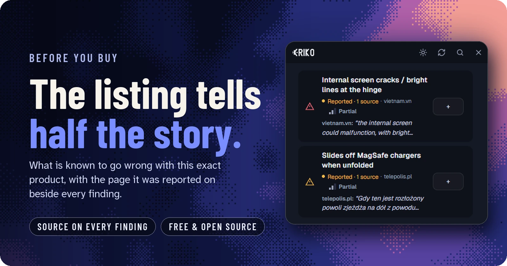
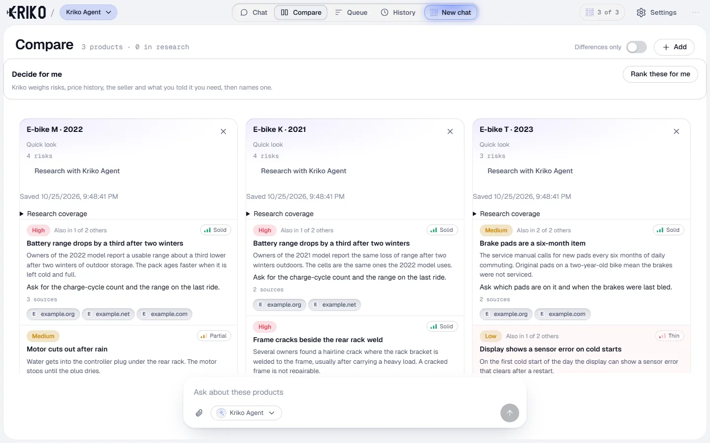
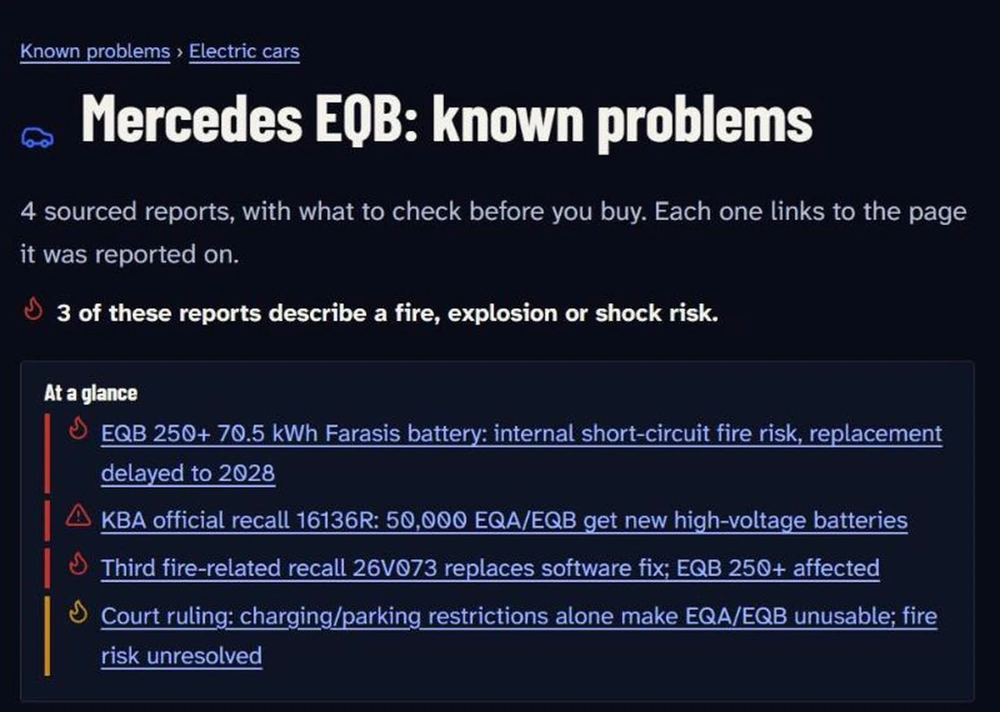
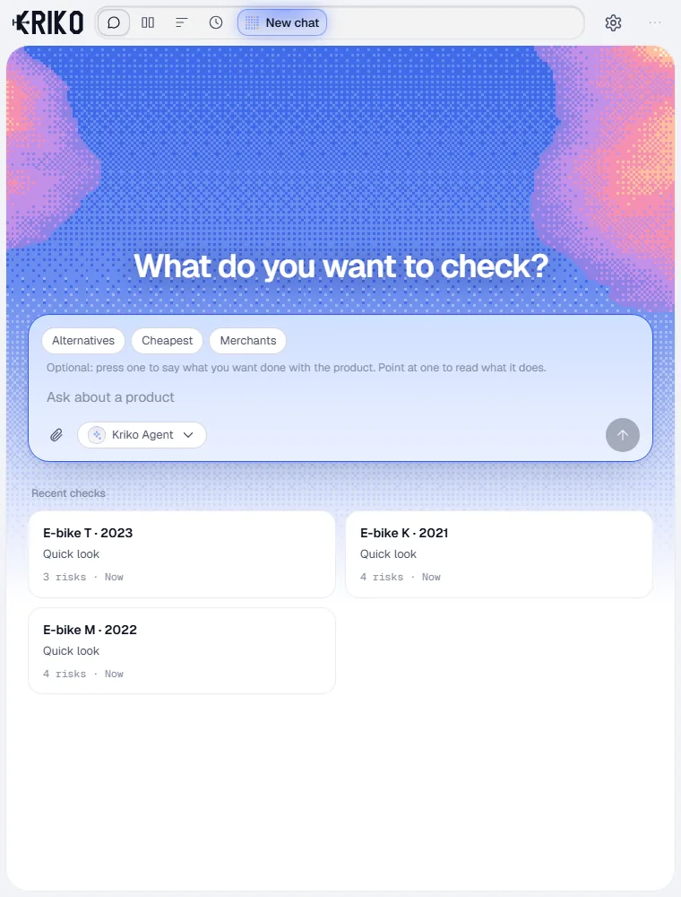
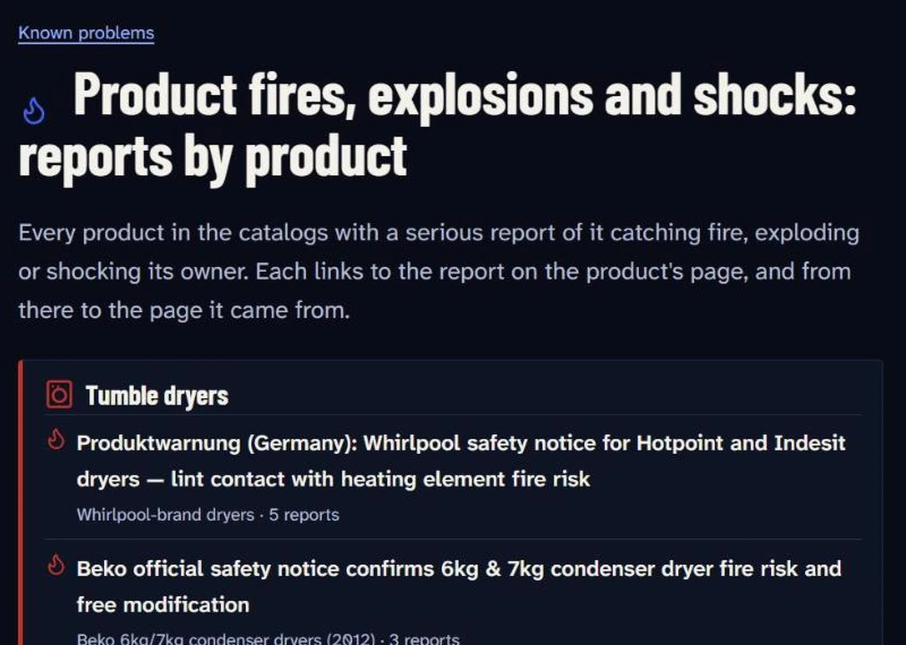
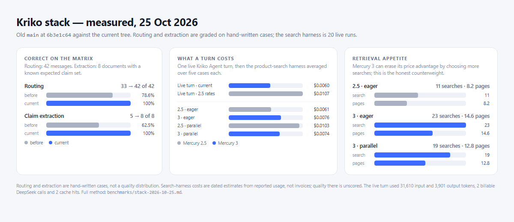

# Kriko

[](https://github.com/Berbadov/kriko/releases/latest)
[](LICENSE)
[](https://github.com/Berbadov/kriko/stargazers)
[](#install)
[](https://kriko.cc/problems/)

Kriko answers one question about the product you are looking at: *what is known
to go wrong with this exact one*. It runs on your computer — a desktop app for
Windows, with an Apple Silicon macOS build made from source, and a browser
extension — and keeps the source beside every finding.
Installed catalog lookups work offline. Research uses the agent or model you
choose, and a paid provider bills your own account.

**[Download the Windows installer](https://github.com/Berbadov/kriko/releases/latest/download/kriko-0.3.8-x86_64-setup.exe)** ·
[Browser extension](https://chromewebstore.google.com/detail/kriko/bdifnaggafjokndlpjgmlfappcoehdjb) ·
[Website](https://kriko.cc) ·
[Known problems by product](https://kriko.cc/problems/) (no app needed)

<p align="center">
  <a href="https://kriko.cc/guide/"></a>
  <br>
  <sub>The real panel, from a live run: every finding names the page it came from. <a href="https://kriko.cc/#film">Watch the 28-second film</a> · <a href="https://kriko.cc/guide/">How to use it, step by step</a></sub>
</p>

0.3.7 makes the Kriko Agent size its search to the product before it goes out,
so a car with faults in six systems is no longer reported from one. The
companion extension is 0.5.0, a quieter panel with Compare inside it, and mobile
is 0.10.0, with a floating scanner you can drag, open and read. See the
[changelog](CHANGELOG.md) for the release scope.

## See it

<table>
  <tr>
    <td width="50%" valign="top" align="center">
      <a href="https://kriko.cc/guide/"><picture>
        <source media="(prefers-color-scheme: dark)" srcset="site/assets/desktop/compare-dark.webp">
        
      </picture></a>
      <br><sub><b>Compare</b> in the desktop app: three listings, the same checks, the sources beside each.</sub>
    </td>
    <td width="50%" valign="top" align="center">
      <a href="https://kriko.cc/problems/mercedes-eqb/"></a>
      <br><sub><b>Known problems by product</b> on <a href="https://kriko.cc/problems/">kriko.cc</a>: no app needed, every report links to its page.</sub>
    </td>
  </tr>
  <tr>
    <td width="50%" valign="top" align="center">
      <a href="https://kriko.cc/guide/"><picture>
        <source media="(prefers-color-scheme: dark)" srcset="site/assets/desktop/home-compact-dark.webp">
        
      </picture></a>
      <br><sub><b>Ask</b> about any product; the answer cites what it read.</sub>
    </td>
    <td width="50%" valign="top" align="center">
      <a href="https://kriko.cc/problems/safety/"></a>
      <br><sub><b>Fires, explosions and shocks</b>, by product: the reports worth knowing before you plug it in.</sub>
    </td>
  </tr>
</table>

## Install

| Artifact | Use |
|---|---|
| `kriko-0.3.8-x86_64-setup.exe` | Per-user Windows installer; no administrator rights required. |
| `kriko-0.3.8-win64-portable.zip` | Extract the whole archive and open `kriko.exe`. |

1. Open Kriko, choose an agent in **More → Agents** and press **Check connection**.
2. Open **Catalogs → Find release catalogs** and install one, or import a
   `.kpack` file. Research also works with no catalog installed.
3. Add [Kriko to Chrome, Edge or Brave](https://chromewebstore.google.com/detail/kriko/bdifnaggafjokndlpjgmlfappcoehdjb),
   keep the desktop app running, and press the toolbar button or **Alt + K** on a
   product listing.

The installer is unsigned, so Windows may warn before it runs. Published desktop
artifacts are Windows x86_64. A native Apple Silicon build is made from source
by the desktop recipe — `kriko-ui/package-macos.sh` — and is not a release
download yet. Details: [Windows installation](docs/INSTALL_WINDOWS.md),
[macOS installation](docs/INSTALL_MACOS.md).

## What it does

- Asks about a product, compares options and continues the same conversation.
- Shows sourced problems, exact variants, specifications and coverage gaps —
  beside the listing through the extension, or in the app.
- Watches a price, ranks a shortlist to one pick, and asks later whether a
  purchase held up.
- Keeps catalogs, conversations and research history on your computer.

Kriko Agent is experimental and runs on your own provider keys; shared access and
the trial are in [shared access](docs/security/shared-access.md). The app's
screens and how to grow knowledge are in [Usage](docs/USAGE.md); matching, the
catalog lifecycle and layering are in [How it works](docs/HOW_IT_WORKS.md).

## The stack, measured

Kriko Agent is a fixed chain — route the question, read Kriko's own records,
research the web when they do not answer, cite the pages, then act in the app —
and it is compared against the previous code rather than described.



- **Routing:** the product-failure question reaches the installed records on
  **42 of 42** test messages, against 33 of 42 before. Ordinary chat and buying
  questions do not move.
- **Claim extraction:** **8 of 8** documents keep their expected claims, against
  5 of 8 before. The old extractor stopped at the first 6,000 characters.
- **One live turn:** 11.45 s, eight pages read, a corrected premise (that engine
  has a belt, not a valve-train chain), the reader's preference saved in **For
  you**, and **$0.0060** spent.
- **The honest cost:** the same tokens cost about 44% less on Mercury 3, but
  Mercury 3 can choose more searches and erase that advantage. The eager
  profile in the product-search harness did exactly that.

The full method, the small-sample caveats and the reproducible commands are in
[the benchmark note](benchmarks/stack-2026-10-25.md). This is a measured
development stack, not a scored quality distribution.

## Your data

Everything lives in `%USERPROFILE%\.kriko` on Windows (`~/.kriko` for a source
installation): `knowledge.sqlite` holds installed catalogs, `app.sqlite` holds
history, conversations and settings, and an update or uninstall keeps the folder.
Nothing leaves the machine except the question a research turn sends to the
provider you chose.

## Build and verify

Source work needs Python 3.13+, Node and a Rust toolchain for the native shell.

```bash
tools/setup.sh
cd kriko-ui && npm ci && cd ..
tools/gate.sh
```

The gate covers Python, the wheel, the extension and website tests, the desktop
app's TypeScript and behavior, and the native checks; a missing native check is
incomplete, not a passing release. See [Architecture](docs/ARCHITECTURE.md), the
[desktop build recipe](kriko-ui/README.md), and
[report a problem](https://github.com/Berbadov/kriko/issues).

## License

[MIT](LICENSE).

## Later

Our own inference service, a fine-tuned model, and statistical knowledge
extraction from forums.
