# Benchmark reports

The [20 October product search screen](searchbench-2026-10-20.md) compares full
web research workflows across easy, heavy and missing-identity questions.
It includes a compact CSV and a screenshot of the plain results table.

Measured results from `kriko model-bench` / `python -m app.modelbench`. What the
columns mean, and the rules behind the arithmetic, are in
[docs/MODEL_BENCHMARK.md](../docs/MODEL_BENCHMARK.md).

Four files per sweep, plus five charts, all cut from the same measurements:

| File | For |
|---|---|
| `modelbench-<date>.md` | Reading. Comparability, the charts, the tables, what the token numbers mean, where each model fails, every run |
| `modelbench-<date>.json` | Everything, including the per-run evidence. Enough to rebuild the other three |
| `modelbench-<date>-candidates.csv` | One row per model, for a spreadsheet |
| `modelbench-<date>-cases.csv` | One row per run |
| `modelbench-<date>-*.svg` | The five charts. Hand-drawn SVG, so they scale, diff in a review, and read correctly on a light or a dark page |

Rebuild a report after a fix without spending anything — the charts are rebuilt
with it, so a corrected rate cannot leave a stale picture standing beside it:

```bash
python -m app.modelbench report --from benchmarks/modelbench-2026-10-18.json
```

To look at a chart as an image, `tools/chart_preview.py` rasterises them with a
headless browser (Chrome or Edge) into PNGs. It is a checking tool, not part of
the report:

```bash
python tools/chart_preview.py benchmarks/modelbench-2026-10-18.json chartcheck
```

## 2026-10-18 — `kriko-configuration` 2026.10.18

Five candidates × 10 cases × 2 repetitions = 100 runs, none failed. On
`DESKTOP-3KUHNFU` (Windows 11, Python 3.14.7). Every candidate received a
byte-identical brief for each case, so the comparison is fair.



The whole decision in one frame: **down and to the left is good.** Three of the
four local models sit in a tight cluster around 850–1,120 tokens per run; the
coding-agent CLI sits an order of magnitude to the right. Bubble area is how many
expected facts each one found, so the largest bubble is not the winner — the
position is.

| Model | Reached by | Answered in shape | Claimed | Correct facts | Hallucinated | Specs found | Wrong specs | Abstained | Tokens/run | Tokens/fact | Median |
|---|---|---|---|---|---|---|---|---|---|---|---|
| `local:qwen3.5:4b` | local | 100% | 22 | 100% (76–100%) | 46% (27–65%) | 100% | 0% | 25% | 862 | 1,436 | 5.3s |
| `local:qwen3.5:0.8b` | local | 60% | 22 | 17% (5–45%) | 91% (72–98%) | 25% | 67% | 0% | 1,010 | 10,095 | 4.0s |
| `local:gemma3n:e2b` | local | 0% | 0 | 0% (0–24%) | — | 0% | — | 0% | 1,116 | — | 9.7s |
| `local:gemma4:e2b` | local | 100% | 27 | 83% (55–95%) | 63% (44–78%) | 75% | 25% | 12% | 956 | 1,912 | 3.2s |
| `harness:mistral-vibe@glm-5-3` | harness | 100% | 13 | 100% (76–100%) | 8% (1–33%) | 100% | 0% | 88% | 8,081 | 13,468 | 11.6s |

Where the fabrications were:

| Model | Items claimed | Not supported | of which a bad quote | Specs returned | Specs wrong |
|---|---|---|---|---|---|
| `local:qwen3.5:4b` | 22 | 10 | **0** | 8 | 0 |
| `local:qwen3.5:0.8b` | 22 | 20 | 12 | 6 | 4 |
| `local:gemma3n:e2b` | 0 | 0 | 0 | 0 | 0 |
| `local:gemma4:e2b` | 27 | 17 | 2 | 8 | 2 |
| `harness:mistral-vibe@glm-5-3` | 13 | 1 | 0 | 8 | 0 |

And where each one fails, case dimension by case dimension — the grid is the
part a reader acts on, because it names the *kind* of reading a model cannot do:



What it says:

- **`qwen3.5:4b` is the strongest on-device extractor, and its one weakness is
  knowing when to stop.** Every expected fact, every specification, on 862
  tokens and in 5.3 seconds. It **never fabricated a quotation** — 0 of 22 — so
  its 46% hallucination rate is over-reaching on claims the documents do not
  make, not misreading. But it abstained correctly on only **2 of the 8 runs
  where the corpus holds no answer**: it fabricated every time on the excluded
  build year, the missing gearbox identity and the consumable-blamed-for-its-host
  case. Abstention is the safety property on a phone, and at 25% it is this
  model's whole risk.
- **`glm-5-3` behind the Mistral CLI is the most trustworthy and by far the most
  expensive.** 100% of the facts, 100% of the specifications, 0 wrong, 88%
  abstention — at **8,081 tokens per run, roughly ten times** the local model.
  That figure is the CLI's whole session (its own system prompt and tool
  descriptions), not the brief, and it is the architectural finding: a
  coding-agent CLI is the wrong shape to put behind a phone.
- **`gemma3n:e2b` produced nothing at all** — 0 of 20 valid JSON. The dashes in
  its hallucination and wrong-spec columns mean *nothing was claimed*, not
  *nothing was wrong*; the only column that shows the failure is recall, at 0%.
- **`qwen3.5:0.8b` fabricates quotations**, which is a different disease from
  `qwen3.5:4b`'s: 12 of its 22 claims quoted text that is not in the page it
  named, and 4 of its 6 specifications were wrong. Not usable for this task.
- **The two leaders are not yet separable on facts**, so the report refuses to
  rank them there — their recall intervals overlap. Only the hallucination,
  token and abstention columns separate them.

### The first run found a defect in the answer key

The first sweep of this corpus scored GLM-5.3 at **25% wrong specifications**.
It had answered `timing drive: timing belt` both times, where the key demanded
the value `belt` — the same answer under a different name, scored as a
fabrication.

That is the corpus's own convention being missed, not a model error: the case
above it already accepts `wet clutch` as an alias for `wet`. The key gained
`timing belt`, the set version went to `2026.10.18`, and every candidate was
re-measured. GLM's wrong-spec rate went to 0% and its specification recall to
100%.

It was found because every run stores the case's answer key beside its score,
and because *Wrong specs* sits next to *Specs found* — a model is never shown
fabricating without the report also showing whether it omitted the figure
instead. **The numbers above are the corrected measurement; the earlier run on
`2026.10.10` is superseded and was not kept, because a report on a key known to
be wrong is worse than no report.**
