# Model benchmark: tokens and fabrication

Measured 2026-10-18T17:26:32+03:00. On DESKTOP-3KUHNFU (Windows 11, Python 3.14.7).

## What was measured

- Corpus **kriko-configuration** version **2026.10.18**
- 10 case(s), 100 run(s), 100 scored, 0 failed
- Candidates: `harness:mistral-vibe@glm-5-3`, `local:gemma3n:e2b`, `local:gemma4:e2b`, `local:qwen3.5:0.8b`, `local:qwen3.5:4b`
- Comparability check passed: every candidate received a byte-identical brief for each of the 10 case(s). The comparison is fair.

> These candidates never returned the requested JSON shape, so they produced no claims to score: `local:gemma3n:e2b`. Their dashes mean *nothing was claimed*, not *nothing was wrong*.

## The comparison

| Model | Reached by | Runs | Failed | Answered in shape | Claimed | Correct facts | Hallucinated | Specs found | Wrong specs | Abstained | Tokens/run | Tokens/fact | Median time |
|---|---|---|---|---|---|---|---|---|---|---|---|---|---|
| `local:qwen3.5:4b` | local | 20 | 0% | 100% | 22 | 100% (76–100%) | 46% (27–65%) | 100% | 0% (0–32%) | 25% | 861.8 | 1,436.3 | 5.3s |
| `local:qwen3.5:0.8b` | local | 20 | 0% | 60% | 22 | 17% (5–45%) | 91% (72–98%) | 25% | 67% (30–90%) | 0% | 1,009.5 | 10,095.0 | 4.0s |
| `local:gemma3n:e2b` | local | 20 | 0% | 0% | 0 | 0% (0–24%) | — | 0% | — | 0% | 1,116.3 | — | 9.7s |
| `local:gemma4:e2b` | local | 20 | 0% | 100% | 27 | 83% (55–95%) | 63% (44–78%) | 75% | 25% (7–59%) | 12% | 955.8 | 1,911.5 | 3.2s |
| `harness:mistral-vibe@glm-5-3` | harness | 20 | 0% | 100% | 13 | 100% (76–100%) | 8% (1–33%) | 100% | 0% (0–32%) | 88% | 8,081.1 | 13,468.5 | 11.6s |

**Answered in shape** is how often the reply was even the requested JSON object, and **Claimed** is how many items it put forward in total. Both are here because the hallucination column needs a visible denominator: a model that produced nothing has *no* hallucination rate, and a dash in that column means "nothing was claimed", never "nothing was wrong".

**Specs found** is the share of requested specifications answered with the key's exact name, value and URL, and **Wrong specs** is the share of the ones it *did* return that were wrong. They are a pair on purpose: a model that returns no figures scores no wrong specs, and only the first column shows that it found nothing.

**Correct facts** and **hallucinated** are pooled over every item produced, with their 95% Wilson intervals in brackets; the interval is the honest part, because a rate from five items is an anecdote. **Tokens/fact** divides counted tokens by expected facts found, so a cheap model that found nothing does not win it.

## What the token numbers mean

| Model | Counted | What the counter saw | In | Out | Total | Notes |
|---|---|---|---|---|---|---|
| `local:qwen3.5:4b` | 20/20 | reported | 639.5 | 222.3 | 861.8 | 20/20 metered |
| `local:qwen3.5:0.8b` | 20/20 | reported | 639.5 | 370.0 | 1,009.5 | 20/20 metered |
| `local:gemma3n:e2b` | 20/20 | reported | 702.7 | 413.6 | 1,116.3 | 20/20 metered |
| `local:gemma4:e2b` | 20/20 | reported | 628.5 | 327.2 | 955.8 | 20/20 metered |
| `harness:mistral-vibe@glm-5-3` | 20/20 | reported total | — | — | 8,081.1 | 20/20 metered |

- **reported** — the endpoint sent a usage block, so the split is real.
- **reported total** — a coding-agent CLI metered its whole session (its own system prompt, its tools, every turn). A large number here is the harness's cost, not the brief's.
- **estimated** — nobody counted; in and out were approximated from characters. Never used by the means above.
- **not counted** — nobody counted and no estimate was safe.

## Who leads, and on what

- **Most expected facts found**: `local:qwen3.5:4b` leads on the point estimate but its interval overlaps `harness:mistral-vibe@glm-5-3`'s. Not yet separable — run more repetitions.
- **Fewest invented claims**: `harness:mistral-vibe@glm-5-3` leads on the point estimate but its interval overlaps `local:qwen3.5:4b`'s. Not yet separable — run more repetitions.
- **Most accurate specifications**: `local:qwen3.5:4b` leads on the point estimate but its interval overlaps `harness:mistral-vibe@glm-5-3`'s. Not yet separable — run more repetitions.
- **Cheapest per expected fact**: `local:qwen3.5:4b` (1,436.3)
- **Fastest median answer**: `local:gemma4:e2b` (3,167)

## What kind of fabrication

| Model | Items claimed | Not supported | of which a bad quote | Specs returned | Specs wrong |
|---|---|---|---|---|---|
| `local:qwen3.5:4b` | 22 | 10 | 0 | 8 | 0 |
| `local:qwen3.5:0.8b` | 22 | 20 | 12 | 6 | 4 |
| `local:gemma3n:e2b` | 0 | 0 | 0 | 0 | 0 |
| `local:gemma4:e2b` | 27 | 17 | 2 | 8 | 2 |
| `harness:mistral-vibe@glm-5-3` | 13 | 1 | 0 | 8 | 0 |

Counts, not rates, because the three failures have different remedies and only the counts show which one a model suffers from. **Not supported** is a claim the documents do not make or a quote that is not in the page it names; **a bad quote** is the subset where the quotation itself does not appear; **specs wrong** is a figure returned under the wrong name, value or URL. A model with many claims and few bad quotes is over-reaching; one with many bad quotes is not reading.

## Where each model fails

| Model | Case dimension | Correct facts | Hallucinated | Runs |
|---|---|---|---|---|
| `local:qwen3.5:4b` | revision | 100% (34–100%) | 0% (0–66%) | 2 |
| `local:qwen3.5:0.8b` | revision | 0% (0–66%) | 100% (51–100%) | 2 |
| `local:gemma3n:e2b` | revision | 0% (0–66%) | — | 2 |
| `local:gemma4:e2b` | revision | 100% (34–100%) | 0% (0–66%) | 2 |
| `harness:mistral-vibe@glm-5-3` | revision | 100% (34–100%) | 0% (0–66%) | 2 |
| `local:qwen3.5:4b` | code-suffix | 100% (34–100%) | 0% (0–66%) | 2 |
| `local:qwen3.5:0.8b` | code-suffix | 0% (0–66%) | 100% (34–100%) | 2 |
| `local:gemma3n:e2b` | code-suffix | 0% (0–66%) | — | 2 |
| `local:gemma4:e2b` | code-suffix | 100% (34–100%) | 50% (15–85%) | 2 |
| `harness:mistral-vibe@glm-5-3` | code-suffix | 100% (34–100%) | 0% (0–66%) | 2 |
| `local:qwen3.5:4b` | long-sku | 100% (34–100%) | 0% (0–66%) | 2 |
| `local:qwen3.5:0.8b` | long-sku | 0% (0–66%) | 100% (51–100%) | 2 |
| `local:gemma3n:e2b` | long-sku | 0% (0–66%) | — | 2 |
| `local:gemma4:e2b` | long-sku | 100% (34–100%) | 0% (0–66%) | 2 |
| `harness:mistral-vibe@glm-5-3` | long-sku | 100% (34–100%) | 0% (0–66%) | 2 |
| `local:qwen3.5:4b` | market | 100% (34–100%) | 0% (0–66%) | 2 |
| `local:qwen3.5:0.8b` | market | 0% (0–66%) | 100% (34–100%) | 2 |
| `local:gemma3n:e2b` | market | 0% (0–66%) | — | 2 |
| `local:gemma4:e2b` | market | 100% (34–100%) | 50% (15–85%) | 2 |
| `harness:mistral-vibe@glm-5-3` | market | 100% (34–100%) | 0% (0–66%) | 2 |
| `local:qwen3.5:4b` | year-exclusion | — | 100% (34–100%) | 2 |
| `local:qwen3.5:0.8b` | year-exclusion | — | 100% (34–100%) | 2 |
| `local:gemma3n:e2b` | year-exclusion | — | — | 2 |
| `local:gemma4:e2b` | year-exclusion | — | 100% (34–100%) | 2 |
| `harness:mistral-vibe@glm-5-3` | year-exclusion | — | — | 2 |
| `local:qwen3.5:4b` | missing-identity | — | 100% (61–100%) | 2 |
| `local:qwen3.5:0.8b` | missing-identity | — | 100% (51–100%) | 2 |
| `local:gemma3n:e2b` | missing-identity | — | — | 2 |
| `local:gemma4:e2b` | missing-identity | — | 100% (51–100%) | 2 |
| `harness:mistral-vibe@glm-5-3` | missing-identity | — | — | 2 |
| `local:qwen3.5:4b` | superseded-source | 100% (34–100%) | 0% (0–66%) | 2 |
| `local:qwen3.5:0.8b` | superseded-source | 0% (0–66%) | — | 2 |
| `local:gemma3n:e2b` | superseded-source | 0% (0–66%) | — | 2 |
| `local:gemma4:e2b` | superseded-source | 100% (34–100%) | 0% (0–66%) | 2 |
| `harness:mistral-vibe@glm-5-3` | superseded-source | 100% (34–100%) | 0% (0–66%) | 2 |
| `local:qwen3.5:4b` | distractor-load | 100% (34–100%) | 0% (0–66%) | 2 |
| `local:qwen3.5:0.8b` | distractor-load | 100% (34–100%) | 0% (0–66%) | 2 |
| `local:gemma3n:e2b` | distractor-load | 0% (0–66%) | — | 2 |
| `local:gemma4:e2b` | distractor-load | 0% (0–66%) | 100% (34–100%) | 2 |
| `harness:mistral-vibe@glm-5-3` | distractor-load | 100% (34–100%) | 0% (0–66%) | 2 |
| `local:qwen3.5:4b` | no-evidence | — | — | 2 |
| `local:qwen3.5:0.8b` | no-evidence | — | 100% (34–100%) | 2 |
| `local:gemma3n:e2b` | no-evidence | — | — | 2 |
| `local:gemma4:e2b` | no-evidence | — | 100% (21–100%) | 2 |
| `harness:mistral-vibe@glm-5-3` | no-evidence | — | — | 2 |
| `local:qwen3.5:4b` | sold-product-vs-host | — | 100% (34–100%) | 2 |
| `local:qwen3.5:0.8b` | sold-product-vs-host | — | — | 2 |
| `local:gemma3n:e2b` | sold-product-vs-host | — | — | 2 |
| `local:gemma4:e2b` | sold-product-vs-host | — | 100% (51–100%) | 2 |
| `harness:mistral-vibe@glm-5-3` | sold-product-vs-host | — | 100% (21–100%) | 2 |

## Run by run

| Model | Case | Dimension | Correct | Missed | Invented | Tokens | Usage | Time | Error |
|---|---|---|---|---|---|---|---|---|---|
| `local:qwen3.5:4b` | pc-revision | revision | 1 | 0 | 0 | 814 | reported | 13.2s |  |
| `local:qwen3.5:4b` | pc-revision | revision | 1 | 0 | 0 | 814 | reported | 4.6s |  |
| `local:qwen3.5:0.8b` | pc-revision | revision | 0 | 1 | 2 | 991 | reported | 8.8s |  |
| `local:qwen3.5:0.8b` | pc-revision | revision | 0 | 1 | 2 | 991 | reported | 2.9s |  |
| `local:gemma3n:e2b` | pc-revision | revision | 0 | 1 | 0 | 917 | reported | 22.2s |  |
| `local:gemma3n:e2b` | pc-revision | revision | 0 | 1 | 0 | 917 | reported | 4.3s |  |
| `local:gemma4:e2b` | pc-revision | revision | 1 | 0 | 0 | 853 | reported | 15.3s |  |
| `local:gemma4:e2b` | pc-revision | revision | 1 | 0 | 0 | 853 | reported | 2.1s |  |
| `harness:mistral-vibe@glm-5-3` | pc-revision | revision | 1 | 0 | 0 | 8,011 | reported_total | 15.8s |  |
| `harness:mistral-vibe@glm-5-3` | pc-revision | revision | 1 | 0 | 0 | 8,082 | reported_total | 11.7s |  |
| `local:qwen3.5:4b` | car-code-suffix | code-suffix | 1 | 0 | 0 | 848 | reported | 13.1s |  |
| `local:qwen3.5:4b` | car-code-suffix | code-suffix | 1 | 0 | 0 | 848 | reported | 5.3s |  |
| `local:qwen3.5:0.8b` | car-code-suffix | code-suffix | 0 | 1 | 1 | 943 | reported | 8.8s |  |
| `local:qwen3.5:0.8b` | car-code-suffix | code-suffix | 0 | 1 | 1 | 943 | reported | 2.4s |  |
| `local:gemma3n:e2b` | car-code-suffix | code-suffix | 0 | 1 | 0 | 916 | reported | 20.7s |  |
| `local:gemma3n:e2b` | car-code-suffix | code-suffix | 0 | 1 | 0 | 916 | reported | 4.3s |  |
| `local:gemma4:e2b` | car-code-suffix | code-suffix | 1 | 0 | 1 | 993 | reported | 15.7s |  |
| `local:gemma4:e2b` | car-code-suffix | code-suffix | 1 | 0 | 1 | 1,059 | reported | 3.2s |  |
| `harness:mistral-vibe@glm-5-3` | car-code-suffix | code-suffix | 1 | 0 | 0 | 7,996 | reported_total | 12.8s |  |
| `harness:mistral-vibe@glm-5-3` | car-code-suffix | code-suffix | 1 | 0 | 0 | 8,200 | reported_total | 10.8s |  |
| `local:qwen3.5:4b` | pc-long-sku | long-sku | 1 | 0 | 0 | 856 | reported | 13.2s |  |
| `local:qwen3.5:4b` | pc-long-sku | long-sku | 1 | 0 | 0 | 856 | reported | 5.3s |  |
| `local:qwen3.5:0.8b` | pc-long-sku | long-sku | 0 | 1 | 2 | 1,213 | reported | 10.0s |  |
| `local:qwen3.5:0.8b` | pc-long-sku | long-sku | 0 | 1 | 2 | 1,213 | reported | 4.0s |  |
| `local:gemma3n:e2b` | pc-long-sku | long-sku | 0 | 1 | 0 | 936 | reported | 21.0s |  |
| `local:gemma3n:e2b` | pc-long-sku | long-sku | 0 | 1 | 0 | 936 | reported | 4.4s |  |
| `local:gemma4:e2b` | pc-long-sku | long-sku | 1 | 0 | 0 | 864 | reported | 15.0s |  |
| `local:gemma4:e2b` | pc-long-sku | long-sku | 1 | 0 | 0 | 864 | reported | 2.1s |  |
| `harness:mistral-vibe@glm-5-3` | pc-long-sku | long-sku | 1 | 0 | 0 | 7,885 | reported_total | 11.2s |  |
| `harness:mistral-vibe@glm-5-3` | pc-long-sku | long-sku | 1 | 0 | 0 | 8,357 | reported_total | 14.8s |  |
| `local:qwen3.5:4b` | car-market | market | 1 | 0 | 0 | 717 | reported | 11.2s |  |
| `local:qwen3.5:4b` | car-market | market | 1 | 0 | 0 | 717 | reported | 3.4s |  |
| `local:qwen3.5:0.8b` | car-market | market | 0 | 1 | 1 | 864 | reported | 7.9s |  |
| `local:qwen3.5:0.8b` | car-market | market | 0 | 1 | 1 | 864 | reported | 2.2s |  |
| `local:gemma3n:e2b` | car-market | market | 0 | 1 | 0 | 883 | reported | 20.3s |  |
| `local:gemma3n:e2b` | car-market | market | 0 | 1 | 0 | 870 | reported | 3.9s |  |
| `local:gemma4:e2b` | car-market | market | 1 | 0 | 1 | 973 | reported | 15.3s |  |
| `local:gemma4:e2b` | car-market | market | 1 | 0 | 1 | 973 | reported | 2.8s |  |
| `harness:mistral-vibe@glm-5-3` | car-market | market | 1 | 0 | 0 | 7,931 | reported_total | 12.4s |  |
| `harness:mistral-vibe@glm-5-3` | car-market | market | 1 | 0 | 0 | 8,104 | reported_total | 11.7s |  |
| `local:qwen3.5:4b` | car-year-outside | year-exclusion | 0 | 0 | 1 | 669 | reported | 10.9s |  |
| `local:qwen3.5:4b` | car-year-outside | year-exclusion | 0 | 0 | 1 | 669 | reported | 3.2s |  |
| `local:qwen3.5:0.8b` | car-year-outside | year-exclusion | 0 | 0 | 1 | 756 | reported | 7.8s |  |
| `local:qwen3.5:0.8b` | car-year-outside | year-exclusion | 0 | 0 | 1 | 756 | reported | 1.9s |  |
| `local:gemma3n:e2b` | car-year-outside | year-exclusion | 0 | 0 | 0 | 820 | reported | 19.9s |  |
| `local:gemma3n:e2b` | car-year-outside | year-exclusion | 0 | 0 | 0 | 833 | reported | 3.9s |  |
| `local:gemma4:e2b` | car-year-outside | year-exclusion | 0 | 0 | 1 | 768 | reported | 14.9s |  |
| `local:gemma4:e2b` | car-year-outside | year-exclusion | 0 | 0 | 1 | 784 | reported | 2.0s |  |
| `harness:mistral-vibe@glm-5-3` | car-year-outside | year-exclusion | 0 | 0 | 0 | 7,744 | reported_total | 11.3s |  |
| `harness:mistral-vibe@glm-5-3` | car-year-outside | year-exclusion | 0 | 0 | 0 | 7,880 | reported_total | 10.2s |  |
| `local:qwen3.5:4b` | missing-fitment | missing-identity | 0 | 0 | 3 | 831 | reported | 12.8s |  |
| `local:qwen3.5:4b` | missing-fitment | missing-identity | 0 | 0 | 3 | 831 | reported | 5.3s |  |
| `local:qwen3.5:0.8b` | missing-fitment | missing-identity | 0 | 0 | 2 | 1,021 | reported | 8.7s |  |
| `local:qwen3.5:0.8b` | missing-fitment | missing-identity | 0 | 0 | 2 | 1,021 | reported | 3.1s |  |
| `local:gemma3n:e2b` | missing-fitment | missing-identity | 0 | 0 | 0 | 1,351 | reported | 25.9s |  |
| `local:gemma3n:e2b` | missing-fitment | missing-identity | 0 | 0 | 0 | 1,343 | reported | 9.7s |  |
| `local:gemma4:e2b` | missing-fitment | missing-identity | 0 | 0 | 2 | 796 | reported | 14.8s |  |
| `local:gemma4:e2b` | missing-fitment | missing-identity | 0 | 0 | 2 | 800 | reported | 2.0s |  |
| `harness:mistral-vibe@glm-5-3` | missing-fitment | missing-identity | 0 | 0 | 0 | 7,932 | reported_total | 11.5s |  |
| `harness:mistral-vibe@glm-5-3` | missing-fitment | missing-identity | 0 | 0 | 0 | 8,042 | reported_total | 11.3s |  |
| `local:qwen3.5:4b` | corrected-bulletin | superseded-source | 1 | 0 | 0 | 741 | reported | 11.1s |  |
| `local:qwen3.5:4b` | corrected-bulletin | superseded-source | 1 | 0 | 0 | 741 | reported | 3.5s |  |
| `local:qwen3.5:0.8b` | corrected-bulletin | superseded-source | 0 | 1 | 0 | 820 | reported | 7.5s |  |
| `local:qwen3.5:0.8b` | corrected-bulletin | superseded-source | 0 | 1 | 0 | 820 | reported | 1.9s |  |
| `local:gemma3n:e2b` | corrected-bulletin | superseded-source | 0 | 1 | 0 | 822 | reported | 18.8s |  |
| `local:gemma3n:e2b` | corrected-bulletin | superseded-source | 0 | 1 | 0 | 822 | reported | 3.2s |  |
| `local:gemma4:e2b` | corrected-bulletin | superseded-source | 1 | 0 | 0 | 796 | reported | 14.6s |  |
| `local:gemma4:e2b` | corrected-bulletin | superseded-source | 1 | 0 | 0 | 796 | reported | 1.9s |  |
| `harness:mistral-vibe@glm-5-3` | corrected-bulletin | superseded-source | 1 | 0 | 0 | 8,106 | reported_total | 12.3s |  |
| `harness:mistral-vibe@glm-5-3` | corrected-bulletin | superseded-source | 1 | 0 | 0 | 7,999 | reported_total | 11.0s |  |
| `local:qwen3.5:4b` | long-table | distractor-load | 1 | 0 | 0 | 1,980 | reported | 11.8s |  |
| `local:qwen3.5:4b` | long-table | distractor-load | 1 | 0 | 0 | 1,980 | reported | 3.7s |  |
| `local:qwen3.5:0.8b` | long-table | distractor-load | 1 | 0 | 0 | 2,098 | reported | 8.1s |  |
| `local:qwen3.5:0.8b` | long-table | distractor-load | 1 | 0 | 0 | 2,098 | reported | 2.2s |  |
| `local:gemma3n:e2b` | long-table | distractor-load | 0 | 1 | 0 | 2,298 | reported | 22.6s |  |
| `local:gemma3n:e2b` | long-table | distractor-load | 0 | 1 | 0 | 2,136 | reported | 3.6s |  |
| `local:gemma4:e2b` | long-table | distractor-load | 0 | 1 | 1 | 1,978 | reported | 14.5s |  |
| `local:gemma4:e2b` | long-table | distractor-load | 0 | 1 | 1 | 1,982 | reported | 1.6s |  |
| `harness:mistral-vibe@glm-5-3` | long-table | distractor-load | 1 | 0 | 0 | 8,947 | reported_total | 12.7s |  |
| `harness:mistral-vibe@glm-5-3` | long-table | distractor-load | 1 | 0 | 0 | 8,911 | reported_total | 12.8s |  |
| `local:qwen3.5:4b` | no-evidence | no-evidence | 0 | 0 | 0 | 518 | reported | 9.0s |  |
| `local:qwen3.5:4b` | no-evidence | no-evidence | 0 | 0 | 0 | 518 | reported | 1.1s |  |
| `local:qwen3.5:0.8b` | no-evidence | no-evidence | 0 | 0 | 1 | 732 | reported | 7.6s |  |
| `local:qwen3.5:0.8b` | no-evidence | no-evidence | 0 | 0 | 1 | 732 | reported | 2.0s |  |
| `local:gemma3n:e2b` | no-evidence | no-evidence | 0 | 0 | 0 | 1,251 | reported | 27.1s |  |
| `local:gemma3n:e2b` | no-evidence | no-evidence | 0 | 0 | 0 | 1,251 | reported | 9.0s |  |
| `local:gemma4:e2b` | no-evidence | no-evidence | 0 | 0 | 1 | 719 | reported | 15.1s |  |
| `local:gemma4:e2b` | no-evidence | no-evidence | 0 | 0 | 0 | 601 | reported | 1.2s |  |
| `harness:mistral-vibe@glm-5-3` | no-evidence | no-evidence | 0 | 0 | 0 | 7,632 | reported_total | 10.9s |  |
| `harness:mistral-vibe@glm-5-3` | no-evidence | no-evidence | 0 | 0 | 0 | 7,595 | reported_total | 10.1s |  |
| `local:qwen3.5:4b` | consumable-host | sold-product-vs-host | 0 | 0 | 1 | 644 | reported | 10.5s |  |
| `local:qwen3.5:4b` | consumable-host | sold-product-vs-host | 0 | 0 | 1 | 644 | reported | 2.7s |  |
| `local:qwen3.5:0.8b` | consumable-host | sold-product-vs-host | 0 | 0 | 0 | 657 | reported | 6.9s |  |
| `local:qwen3.5:0.8b` | consumable-host | sold-product-vs-host | 0 | 0 | 0 | 657 | reported | 1.3s |  |
| `local:gemma3n:e2b` | consumable-host | sold-product-vs-host | 0 | 0 | 0 | 1,308 | reported | 25.3s |  |
| `local:gemma3n:e2b` | consumable-host | sold-product-vs-host | 0 | 0 | 0 | 801 | reported | 3.5s |  |
| `local:gemma4:e2b` | consumable-host | sold-product-vs-host | 0 | 0 | 2 | 839 | reported | 15.4s |  |
| `local:gemma4:e2b` | consumable-host | sold-product-vs-host | 0 | 0 | 2 | 824 | reported | 2.2s |  |
| `harness:mistral-vibe@glm-5-3` | consumable-host | sold-product-vs-host | 0 | 0 | 1 | 8,414 | reported_total | 12.9s |  |
| `harness:mistral-vibe@glm-5-3` | consumable-host | sold-product-vs-host | 0 | 0 | 0 | 7,854 | reported_total | 11.6s |  |

