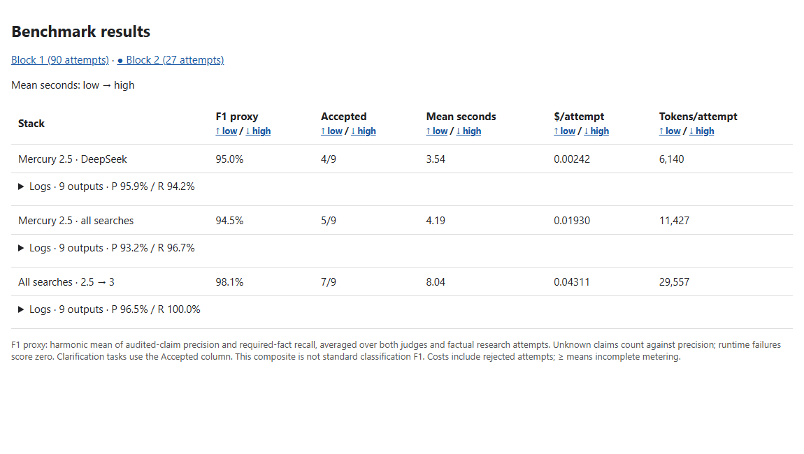

# Product search screen: 20 October 2026

117 research attempts across nine product prompts. Categories are shoes, computers
and cars. Each has an easy, heavy and missing-identity question. A separate screen
made 108 retrieval calls. Both evaluators graded every research attempt.

Block 1 compares ten profiles. Block 2 compares the combined stack with controls.
The second block reuses the nine prompts. Keep the blocks separate.

| Block 2 profile | F1 proxy | Accepted | Mean seconds | Estimated USD/attempt | Known tokens/attempt |
|---|---:|---:|---:|---:|---:|
| Mercury 2.5 + DeepSeek | 95.0% | 4/9 | 3.54 | 0.00242 | 6,140 |
| Mercury 2.5 + all three search providers | 94.5% | 5/9 | 4.19 | 0.01930 | 11,427 |
| All search providers + Mercury 2.5 draft + Mercury 3 verification | 98.1% | 7/9 | 8.04 | 0.04311 | 29,557 |

F1 is a descriptive proxy from claim audits and required-fact recall.
It does not include the separate critical-fact and source-grounding acceptance gates.
The [method](../docs/PRODUCT_SEARCH_BENCHMARK.md) defines the arithmetic and limits.
These are model-assisted estimates from a small screening set, not a production reliability result.
No comparison with Google was measured.



[CSV summaries](searchbench-2026-10-20.csv) retain sample sizes, known-cost flags,
F1 coverage, source hashes and corpus hashes for both blocks.
Raw answers and page evidence remain in the local experiment folders.

Generate the table from saved experiments without more paid calls:

```powershell
python -m app.searchbench.listing FIRST_FOLDER SECOND_FOLDER --out .local-evaluation/searchbench/simple-results
```

Open `index.html`. Copy the whole output folder to retain all sort links and logs.
