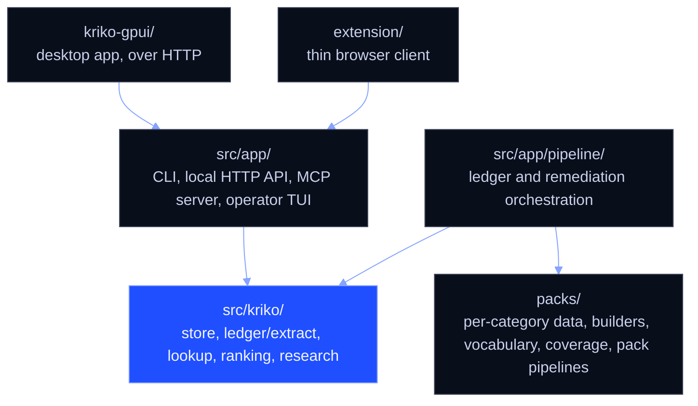

# From request to done

How work gets from "the reader asked for it" to "the reader has it". The aim
since 2026-10-12: about **a fifth** of the effort on process (tests, version
control, proof), the rest on the product. A rule stays only if it has caught
a real defect; ceremony that only checked other ceremony was cut.

| # | Rule | One line |
|---|---|---|
| 1 | Know what was asked | Quote the reader; write **Done when** before code |
| 2 | Done is observed | Seen where the reader sees it, on Windows where it differs |
| 3 | Reproduce first | A bug fails on purpose before it is fixed |
| 4 | Test behaviour, not prose | One test per behaviour change; none for documents |
| 5 | Proof in the PR, sized to the change | What changed, what was seen, what is not done |
| 6 | Say when it fails | Partial is partial |

## 1. Know what was asked

Quote the reader, never paraphrase ("sliders" becomes "chips"), and write
**Done when**: a reader-visible outcome. No "Done when" means not understood:
ask, never guess.

Where it lives depends on size:

- **Up to a day of work:** the PR description holds the quote and the Done
  when. No issue.
- **Bigger, or more than one PR:** a GitHub issue from the **Request** template
  (`.github/ISSUE_TEMPLATE/request.md`), closed by the PR (`Closes #n`).
  Mirroring to Linear is optional.

## 2. Done is observed

Done means the end result happened, seen as is where the reader sees it. A
screen that changed is looked at (a screenshot in the PR); a change with no
screen is shown by its output. Where Windows can differ (the shell, the
installer, the tray), the PR says whether it was checked there. Shipped is a
double-clicked installer.

## 3. Reproduce first

A bug fails on purpose first: a test, a symptom script, or a reproduced
screen. No prior failure is a guess. Three failed fixes in one place mean the
model of the problem is wrong.

## 4. Test behaviour, not prose

- A behaviour change brings its test in the same commit; a retired behaviour
  takes its test with it.
- Break a new guard once to see it fail. A test that never failed tests nothing.
- Stub the edge (network, CLIs), not the middle.
- **No tests whose only job is to keep a document in step with the code**
  (tables of endpoints, lists of tables). A document that misleads is fixed
  when someone is misled. What agents *execute* from text is different and
  stays tested: the generated skill, the tools a brief names.
- `tools/gate.sh` before every push. It is the one check that has repeatedly
  caught real defects.

## 5. Proof in the PR, sized to the change

Every PR says what changed, what was observed (real output or a screenshot),
and what it does not do yet. A second, uninvolved agent reviews only PRs over
about 500 changed lines or touching lookup and claim selection. The reader
merges; nothing reaches `main` without that.

## 6. Say when it fails

Partial is partial: what is missing and why. "It should work" is not a status.
A button that cannot work on this machine says so on screen, with the
alternative next to it.

## Set up the working tree

Three commands cover a working tree:

```bash
tools/setup.sh                 # working tree (idempotent: run whenever something feels wrong)
tools/gate.sh                  # everything the branch used to be checked for
python tools/bump.py X.Y.Z     # version, in all four places it lives
```

`setup.sh` pins the interpreter floor from `pyproject.toml`, `requirements.lock` as the frozen closure, `-e .` so `app.version` reports the tree, the `pipeline` extra required for the suite, and wiping stale `src/*.egg-info`. It installs the root Node dependencies for the browser extension checks. It never touches `~/.kriko`: the store, history and keys are not a dev environment.

`python tools/bump.py --show` checks three committed files (`pyproject.toml` and the app's `Cargo.toml` and `Cargo.lock`) plus installed-distribution metadata (what `/api/health` reports; a tree at 0.8.1 with a 0.8.0 editable install serves 0.8.0). It never commits or tags.

The MCP server (`.mcp.json`) runs `tools/kriko_mcp.py`, which finds an engine (`KRIKO_PYTHON`, this or the main checkout's `.venv`, the running interpreter, an installed app) rather than assuming one venv path; `python3 tools/kriko_mcp.py --print` says which it would start.

## Branches and commits

Branch off `main`. Nothing reaches `main` without the author asking.

Every change set must bump the app version and update `README.md` before it is committed, including fixes, features, documentation, configuration, and packaging changes. Use `python tools/bump.py X.Y.Z`; it also updates the README badge and download filenames. Add a description of the change to the README. Published tags and assets are immutable: a correction ships as a newer version. Follow [the update protocol](UPDATE_PROTOCOL.md) for building and publishing.

Conventional commits with scope, as history uses:

| Prefix | For |
|---|---|
| `feat(hub):` | a new behaviour |
| `fix(hub):` | a bug; name the cause |
| `refactor(ops):` | structure, same behaviour |
| `docs:` | documents only |
| `chore(git):` | housekeeping |
| `perf(hub):` | measured, with numbers |

The body is for `git log` in six months: the cause, not the symptom (*"the picker armed an unsucceedable onboarding run"* over *"fix picker bug"*), and what you chose not to do when the choice is not obvious.

## Tests

```bash
python -m pytest        # all tests, no arguments
npm test                # extension scraper + panel
```

Run `pytest` bare: `pytest.ini` pins `testpaths`, and naming directories skips `app/pipeline/tests` silently (576 of 761 tests once). The suite must pass with **no API keys and no `.env`**; a keyed test reaches the network and belongs behind a marker.

After moving a serving-path module, also run:

```bash
python -c "import app.web.app, kriko.lookup, kriko.store"
python -m pytest src/app/pipeline/tests/test_repo_invariants.py
```

Serving is the local FastAPI app on the SQLite pack store; the pipeline stays separate, so importing `app.web.app` must not load `app.pipeline` or the LLM stack.

## User interfaces

The GPUI desktop app is the native interface. The browser extension reads a
listing and calls the local FastAPI API. `python -m app.web` starts the API;
`/` reports the service identity, `/api/health` reports liveness, and
`/api/docs` exposes its interactive API documentation. There is no Svelte
dashboard or committed static bundle.

## Dead code

`grep` for a dotted path misses `from x import y` and falsely reports live modules as dead. Before deleting on "nothing imports this", check all import styles, entry points and doc mentions; the record of past findings is in `git log`.

## Architecture

Dependencies flow one way; import down, never up.



Needing something from above means **the module is in the wrong layer, so move it.** An upward deferred import (a function-body import hiding `partially initialized module`) is the smell; a downward one is just startup cost. `test_repo_invariants.py` enforces this. `CLAUDE.md` has the exact `grep` checks and the packs-through-the-store rule.

## The gate

```bash
tools/gate.sh            # everything
tools/gate.sh py         # version strings, ruff, mypy, pytest
tools/gate.sh node       # scraper and extension panel
tools/gate.sh wheel      # the shipped wheel imports and runs
tools/gate.sh gpui       # cargo check and cargo test, offline
```

| Gate | Catches |
|---|---|
| `tools/bump.py --show --strict` | version strings that disagree |
| `ruff`, `mypy` | lint, and types in `src/kriko`, `src/app` and `packs` (three runs) |
| `pytest` | full suite + the layering and testpaths invariants |
| `tools/smoke_wheel.sh` | a wheel that no longer imports what the checkout does |
| `npm test` | scraper and extension-panel tests (jsdom); a run of zero tests fails |
| `cargo check`, `cargo test` | the desktop app; skipped, with the remedy, when there is no `cargo` or the registry cache is cold |

**It runs on your machine, as a deliberate retreat.** These were `ci.yml`'s
three jobs, moved verbatim into `tools/gate.sh` on 2026-09-13 when the
account's Actions minutes ran out: every run failed in under 15 seconds with
no logs, which is red ticks on untested commits, and a signal that is always
red teaches ignoring red. The obligation moved with them, so run it before you
push. Restoring the workflow is `git revert` then the billing change, in that
order. Do not block on CI: push, tag, keep working.

No docker-build job, ever: Kriko is a standalone app, not a deployment
(`test_the_app_stays_standalone` fails on a Dockerfile, compose files, a
`deploy/` directory or a Postgres driver).

The `desktop` workflow is untrimmed but **hand-run only** (`workflow_dispatch`;
the tag and pull-request triggers were removed 2026-09-13 for the same minutes
reason). It runs the same recipe as `kriko-gpui/package.ps1`, step for step:

| Job | Does |
|---|---|
| `bundle` | Windows: freezes the sidecar, builds the app and the installer, runs both smoke checks (`packaging/smoke_sidecar.py`, `packaging/smoke_app.py`) |
| `packs` | builds every catalog and writes the index |
| `release` | tags only: collects the installers into a release |

Run it from the Actions tab, or build on a Windows host per
[`kriko-gpui/README.md`](../kriko-gpui/README.md), which is how every installer so
far was made.

The gate runs with no secrets. Root `npm test` uses `npm install` (its lockfile
is gitignored); the `ui` gate uses `npm ci` (lockfile committed), because
floating dependencies would change asset hashes and fail the bundle check
spuriously.
