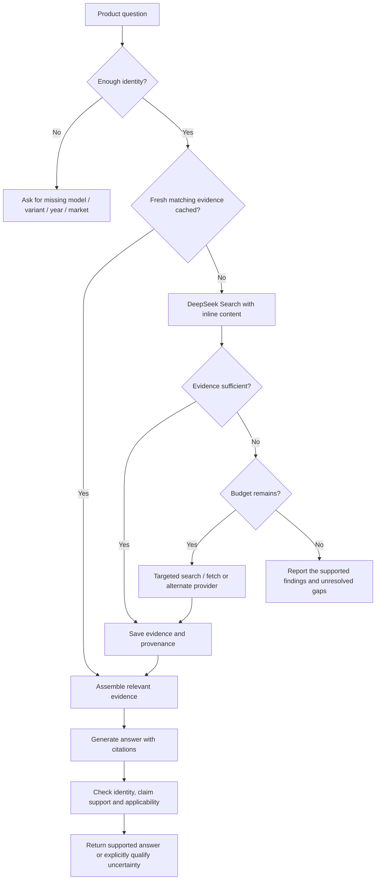
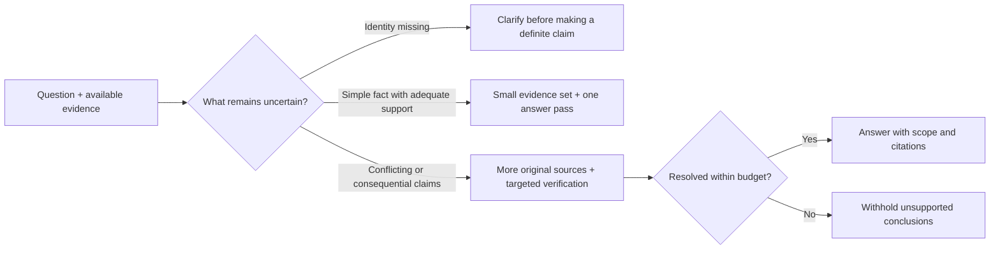

# Minimal product-search stack

Research proposal · 20 October 2026 · Not an implementation or a benchmark winner.

**Goal:** reliable, cited product research with low latency and low cost. Use
DeepSeek for discovery, retain useful evidence, and spend more only when a
question needs it. Evaluate cars, computers and shoes separately, including
easy questions, heavy research and missing product identity.

## Start with these components

| Component | Initial choice | Role |
|---|---|---|
| Research controller | Our Python harness + async HTTP | Query planning, parallel reads, deadlines and spend limits |
| Primary retrieval | DeepSeek Search with `need_content=true` | Search and inline page content in one request |
| Additional reads | DeepSeek Fetch | Read missing content or resolve a specific evidence gap |
| Evidence store | SQLite; optional FTS5 | Reuse documents, quotations, product identity and timestamps |
| Answer model | Benchmark Mercury 3 against Mercury 2.5 | Produce concise answers grounded in supplied evidence |
| Selective alternatives | Exa / Tavily; Ministral / Mistral Large 4 | Test retrieval recovery and stronger verification when needed |

Model roles are candidates to test. Do not run every provider and model for
every question. Keep credentials on the service side when using a hosted backend.

## Request flow



Cache evidence by exact product identity, market, source URL and retrieval time.
Apply shorter freshness windows to recalls and changing policies than to stable
specifications. Preserve the supporting passage, not just a generated summary.

## Allocate effort by uncertainty



A shoe can require heavy research; a car question can be a simple lookup.
Route by the actual question, evidence gaps and consequences of error.

## Cost baseline

DeepSeek lists **$0.75 per 1,000 successful search requests** and the same
price for fetch requests. Search can include page content; additional fetches
are not automatically required. These are retrieval charges, excluding model
tokens and other infrastructure. [Official billing and API documentation](https://api-docs.deepseek.com/guides/search/)

| Successful DeepSeek search calls | Search charge |
|---:|---:|
| 1,000 | $0.75 |
| 10,000 | $7.50 |
| 100,000 | $75.00 |
| 1,000,000 | $750.00 |

```text
DeepSeek retrieval charge = $0.00075 × (billable searches + billable fetches)
Total service spend = retrieval + model tokens + other providers + hosting
Cost per 1,000 accepted answers = total spend on all attempts / accepted answers × 1,000
```

A successful API request is not necessarily a correct answer. Include research
that produced wrong answers, timeouts and retries in service-level accounting.

## Open-source components to investigate later

Add components when a measured gap justifies their maintenance and hosting cost.

| Candidate | Question to investigate |
|---|---|
| [Crawlee](https://crawlee.dev/python) | Would owning selected crawls improve coverage or freshness? |
| [Trafilatura](https://trafilatura.readthedocs.io/en/latest/) | Can local extraction recover useful content more cheaply? |
| [OpenSearch](https://docs.opensearch.org/latest/vector-search/ai-search/hybrid-search/index/) | When does the evidence collection justify a separate hybrid index? |
| [Sentence Transformers](https://sbert.net/examples/cross_encoder/applications/README.html) | Does local reranking improve supported accuracy enough to pay for its latency? |

## Questions for the research and benchmark

- Which sources resolve the exact product variant, year and market reliably?
- When is DeepSeek inline content sufficient, and when does a fetch add useful evidence?
- When do Exa or Tavily recover evidence the primary search missed?
- Which model minimizes cost and latency **at an acceptable supported-accuracy level**?
- Does verification catch real errors, or merely repeat the first answer?
- What are the appropriate freshness windows and stopping budgets?

Record input/cached-input/output/reasoning tokens, every provider request,
estimated charges, cache hits, first-answer latency, completion latency and
failure rates. Report sample counts and uncertainty alongside p50/p95.
Keep evaluation-model costs separate from the runtime service cost.

Score exact identity, required facts, citation support, scope errors and useful
clarification/abstention. Keyword coverage alone is insufficient. Compare both
individual workloads and a declared workload mix; do not pool incompatible
development runs into one ranking.
