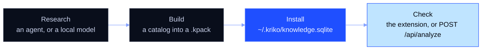
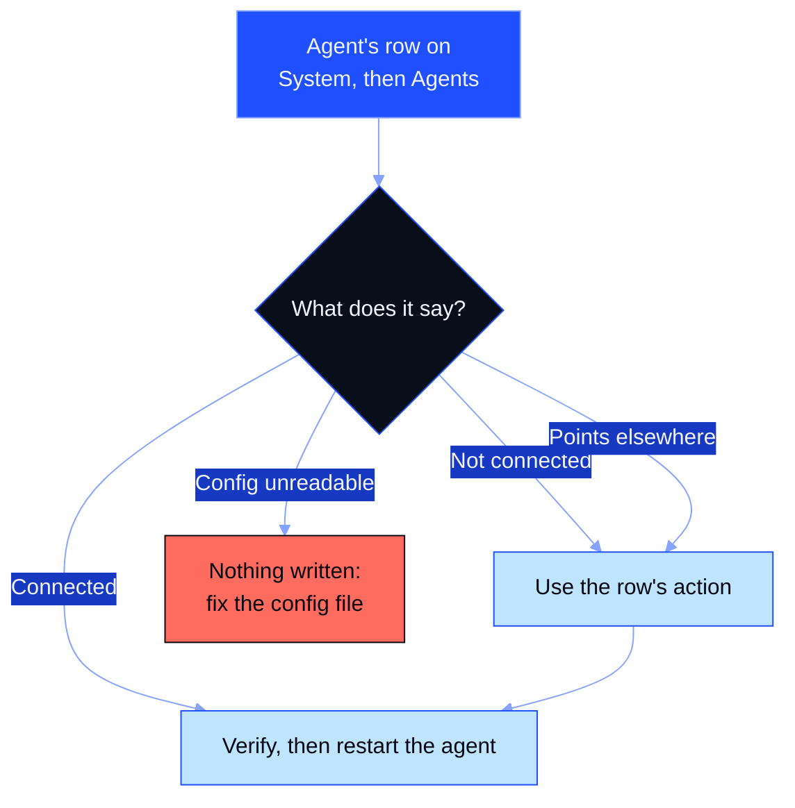
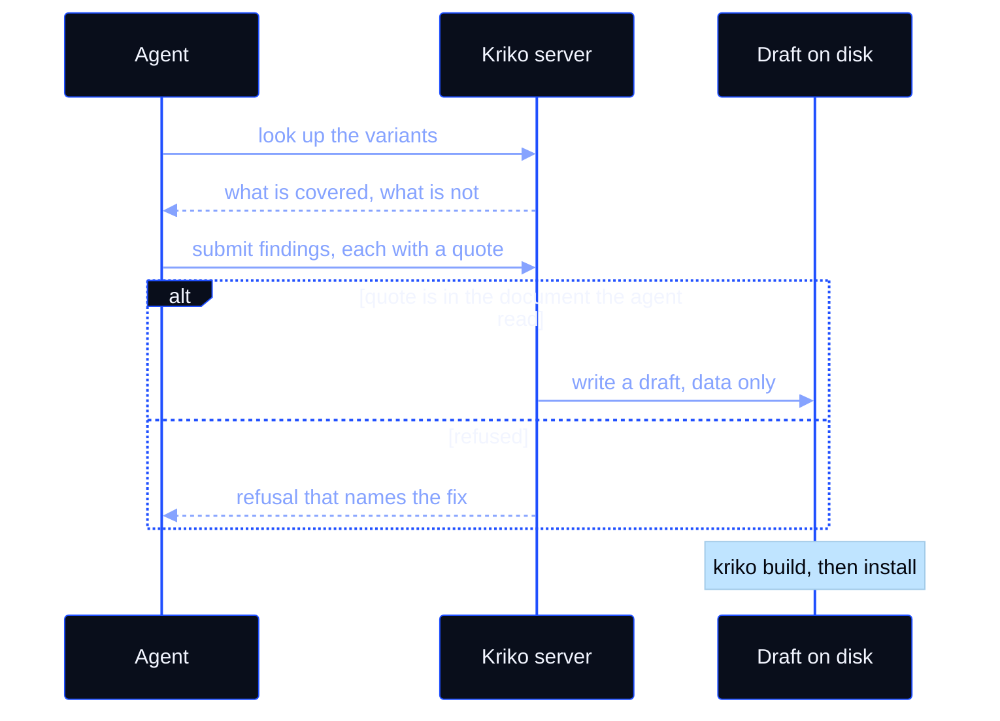
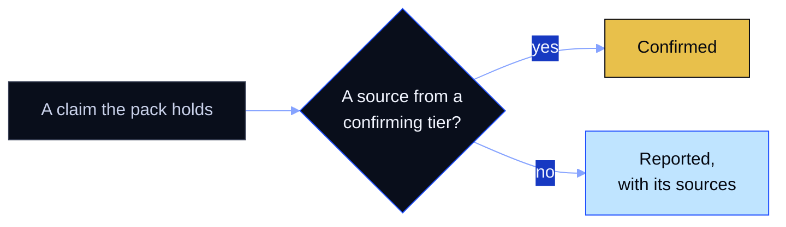

# Kriko, usage

Run it, load the extension, connect an agent, grow the knowledge. The mechanism
is in [INTERNALS.md](INTERNALS.md).



## Prerequisites

| For | You need |
|---|---|
| **Desktop app** | Nothing. It carries its own Python; no Docker, no Postgres. Store `~/.kriko/knowledge.sqlite`, history `~/.kriko/app.sqlite` |
| **Checkout work** (pipeline, CLI, tests) | The interpreter floor in `pyproject.toml`, which is 3.13 |
| **Research keys** | Only the hosted planes, and only the one you choose. Set them in the environment or on the app's Settings screen, which stores them under `~/.kriko/env`. Serving a lookup needs no key at all |

## 1. Run it

Install `kriko-<version>-x86_64.msi` (a per-user install with no admin prompt)
and launch it — the installer's last screen offers to do that for you. A first
launch walks the places a check needs (a catalog, an agent, the extension);
Settings → General → **Take the tour** shows it again. `kriko-gpui/package.ps1` builds it; the `desktop` workflow runs
the same recipe. See `kriko-gpui/README.md`, and
[INSTALL_WINDOWS.md](INSTALL_WINDOWS.md) for the steps. From a checkout:

```bash
.venv/bin/python -m app.web            # http://127.0.0.1:8787
curl http://127.0.0.1:8787/api/health  # {"ok":true,"store":...,"app_state":...}
```

On Windows, closing the window leaves Kriko in the system tray so the browser
extension can keep using the engine. Open it again from the tray or the desktop
shortcut. Choose **Quit Kriko** in the tray to stop the engine too. The tray
tooltip says whether the engine is ready, still starting, or stopped.

> Port 8787 taken? In the desktop app's **Browser extension** screen, enter a
> free port and choose **Save port and restart engine**. Then open the browser
> extension's settings and set its address to the one shown in the app, such
> as `http://127.0.0.1:8790`. The choice survives desktop restarts. A port
> conflict leaves the app open and marks the extension listener unavailable.

## 2. The browser extension

**From the app:** Check, then Browser extension, then stage the files. They
land under `~/.kriko/extension/`, and the page turns green when the extension
first reaches the app.

**From a checkout:** `chrome://extensions`, Developer mode, Load unpacked,
select `extension/`. Open a page an adapter can read; the panel appears after
about 1.5 seconds.

The small toolbar icon is coloured when the app answers and muted when it
cannot be reached. Chrome refreshes that state about once a minute. Any number
or question mark on the icon describes the current page, not the connection.
Click the icon to open the panel on the page.

> After an app update, or any change under `extension/`: stage again, then the
> browser's Reload (the circular arrow on the extension's card at
> `chrome://extensions`).

> The panel is missing on a page it used to read? System, then Sites
> says which of the two it is: the site needs a permission the browser has not
> granted, or no adapter reads it yet.

## 3. Connect a coding agent

The default plane costs nothing extra, because the reading is done by an agent
you already pay for. Open System, then Agents, and use the one action on that
agent's row to connect it.

| State | Meaning |
|---|---|
| Not connected | No `kriko` server in the agent's config. |
| Connected | Names this window's store. |
| Points elsewhere | Names a different `knowledge.sqlite`; findings land where this window never reads. |
| Config unreadable | Will not parse; nothing written. |



*Verify* runs a real MCP handshake and tool listing, and shows each step's
result. Restart the agent afterwards. The research skill is assembled from the
installed catalogs and served at `GET /api/agent-skill`; it names no screen, no
product, no harness and no model, and `src/app/agentskill.py` writes a content
digest so the app can tell when the copy on disk has fallen behind. One binary
serves both roles:

```bash
kriko-sidecar --mcp --store ~/.kriko/knowledge.sqlite   # installed
python -m app.sidecar --mcp                             # checkout
```

The tool list lives in `src/app/mcp_server.py`. Findings enter as drafts
through `app/findings.py`, which refuses a quote that is not in the document
the agent says it read.

**A local model instead.** This install, then Local LLM, sets the address of a
model server running on this machine and which model to use. [Setting one up](#local-models)
is below. The plane reports
whether it is ready, and a run started without naming a plane uses it first.
The one thing it cannot do alone is search: it uses a hosted keyless search
until a local search service is available.

### Local models

A local model answers on your own computer. Ollama is the app that runs its
downloaded model files. Research can still search the web. Open **Local LLM**
in the app.

Press **Set up Ollama and the recommended model** to install Ollama, download
`gemma4:e2b` (the model Kriko recommends) and select it. Ollama comes from its
own site, the installer's signature is checked before it runs, and the download
shows its byte count. If you already run Ollama, Kriko uses `gemma4:e2b`
whenever it is downloaded and you have not chosen another model; the **Local
LLM** list marks it *Recommended*. If an earlier install was interrupted and
left Ollama unable to run models, setup notices and reinstalls it, and
downloaded models are kept. Allow about 8 GB of free space for the app and the
model. Larger models need more disk space and memory.

If automatic setup fails, press **Download Ollama manually**, run its installer,
return to Kriko and press **Check again**. If Ollama is installed but stopped,
**Start Ollama** starts it without downloading a model. **Browse downloadable
models** downloads another model with progress, then select it. A model
download can be cancelled from its progress card.

Small models can miss detailed configurations. The Benchmark screen's
configuration suite measures missed facts, unsupported claims, wrong
specifications, correct abstention, time and token usage on fixed development
cases. It is not a real-world accuracy guarantee.

## 4. Terminal

Store-only commands need no server; the rest attach to a running app or start
an engine for one command (`--no-start` fails instead, `--url` or `KRIKO_URL`
picks one).

| Command | Does |
|---|---|
| `kriko packs`, `install`, `uninstall`, `enable` | Manage installed catalogs |
| `kriko build packs/<name>` | Build a catalog directory into a `.kpack` |
| `kriko lookup` | Ask the installed catalogs about a product |
| `kriko agenda`, `brief`, `submit` | What to research next, one subject's brief, file findings |
| `kriko prefs`, `costs` | Chosen providers (`--model NAME`), measured spend and the next estimate |
| `kriko sites [register HOST\|forget HOST]` | What this installation can read, and teaching it a site |
| `kriko verify [--list] [--pack ID] [--subject ID]` | Re-read a claim's sources |
| `kriko drafts [show\|amend\|build\|install\|discard SLUG]` | Agent-written catalog drafts |
| `kriko operations`, `bench --cases 5` | The live work feed; measure the research planes |
| `kriko tui` | Operator console |

## 5. Add a product to a catalog

The default path costs nothing extra: hand the agent the product and let it
work.

```
use the kriko-research skill to research <product>
```



The agent looks up the variants first, because naming is cheap and research is
what is expensive, and Kriko writes down the products the agent did not cover
rather than losing them. What comes back is a draft on disk: data only, nothing
executable.

The server refuses what a prompt could only ask for, so do not retry a refusal
reworded: a quote that is not in the submitted document text, a figure with no
source, a value nobody can derive, a lineup that does not match the category,
and rows the pack's own bar excludes. A refusal names the fix.

**Manual fallback**, which is what the agent drives. The ledger stages are the
same for every pack; anything a pack adds on top (catalog discovery, its own
validators, its agent files) is that pack's business and is listed in its
`README.md` with its own arguments.

```bash
# 1. Evidence per component, then the ledger stages
python -m app.pipeline.ledger_run acquire --part <code>
python -m app.pipeline.ledger_run all
# 2. Build and install
kriko build packs/<name>
kriko packs
```

| Command | Use |
|---|---|
| `ledger_run` subcommands | `acquire backfill extract resolve cluster verdict export report remediate all` |
| `python -m app.pipeline.ledger_run remediate --dry-run` | Unattended gap-filling from the coverage report; `--max-usd` caps spend, one line per pass in `logs/remediation.jsonl` |
| `python -m app.pipeline.panel` | Spend, cost to finish, coverage, recent runs. Check it before any paid run |
| `python -m app.pipeline.process --help` | End-to-end driver for one product, in whatever identity keys that pack declares; `--skip-extraction` replays cached candidates for free |

Processing writes YAML. Nothing serves until the catalog is rebuilt and
installed. Statuses are pipeline-owned, so never hand-edit `status`.

## What a reader sees

| Shown as | When |
|---|---|
| Confirmed | At least one source is from a confirming trust tier, `authoritative` or `manufacturer`. The card shows a relevance number. |
| Reported | Every other claim. The card shows its sources and no number. |



The pipeline keeps a claim only with quotes it has grounded in the document it
read. The engine serves the claims a pack holds for the product and does not
check their quotes again. The strength shown on a card comes from the trust tier
of its sources (`extension/background.js`, `_strengthOf`).

## Check the store

```bash
sqlite3 ~/.kriko/knowledge.sqlite "SELECT pack_id, version, built_at FROM packs;"
sqlite3 ~/.kriko/knowledge.sqlite "SELECT subject_id, kind FROM subjects LIMIT 20;"
```

`/api/health` reports both file paths. Full payloads of past checks are in
`logs/analyses.jsonl`.
