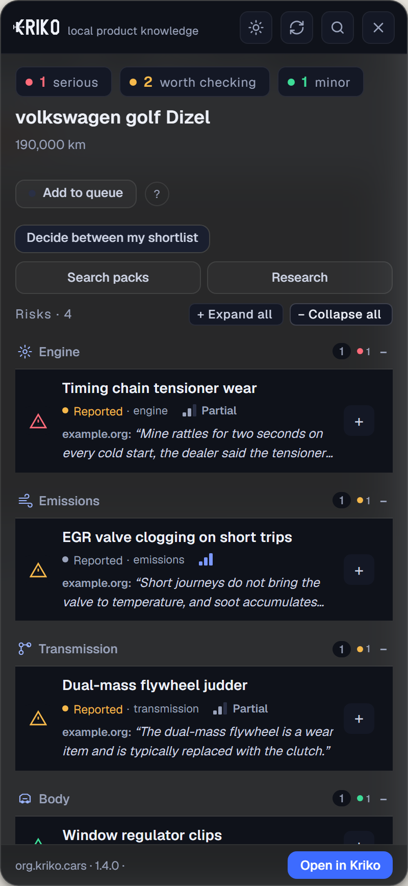
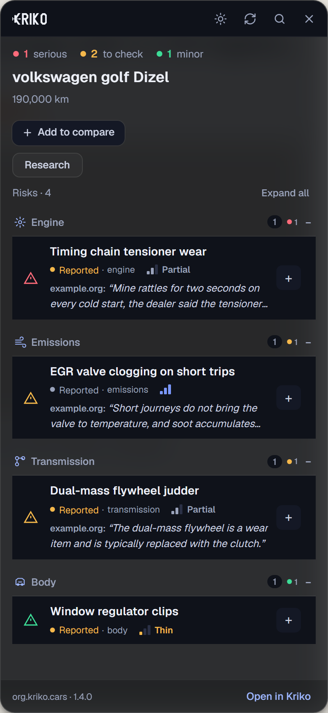
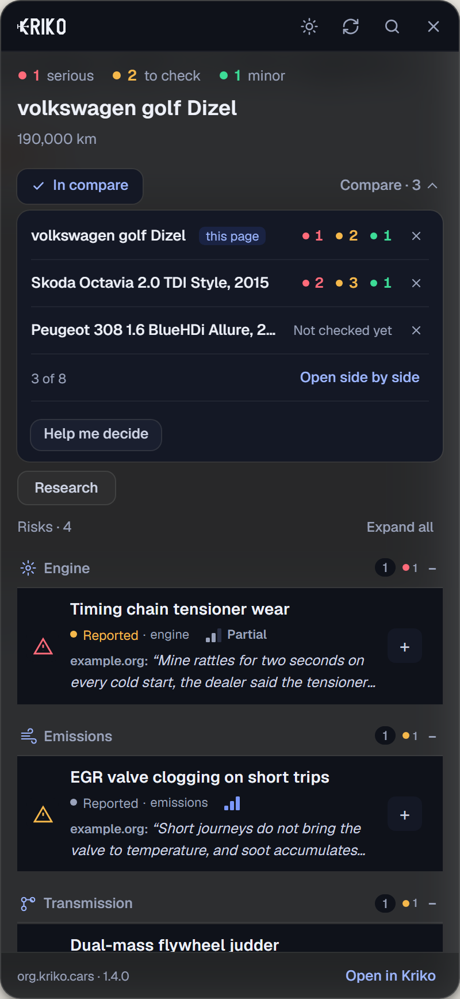
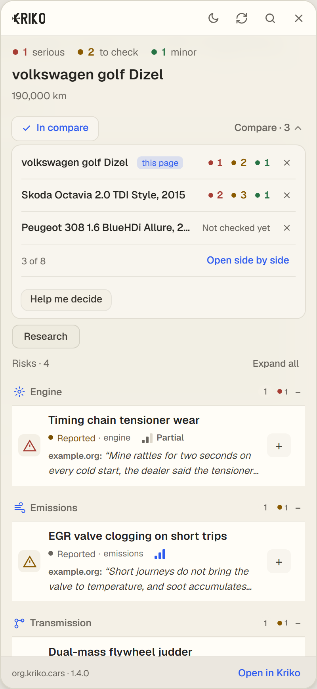
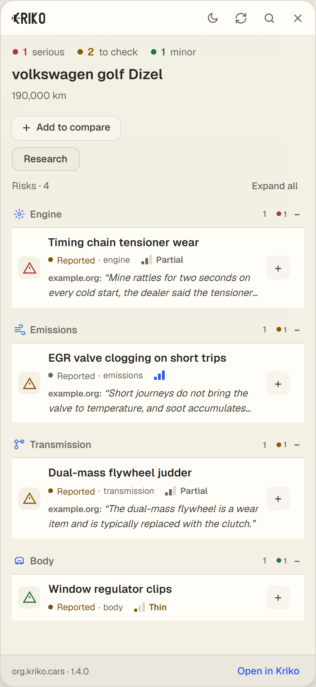
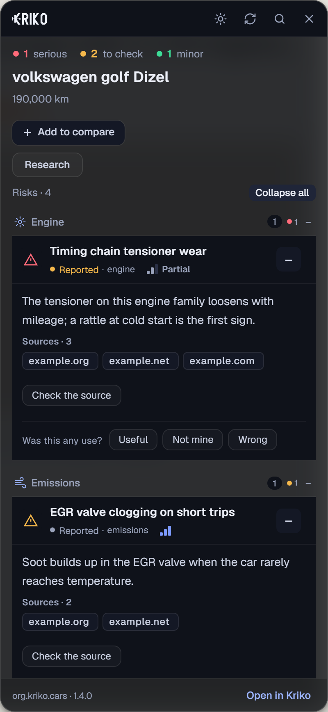
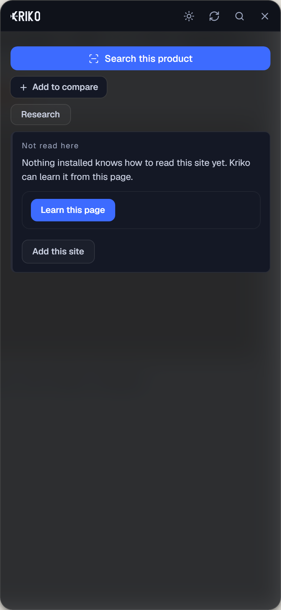
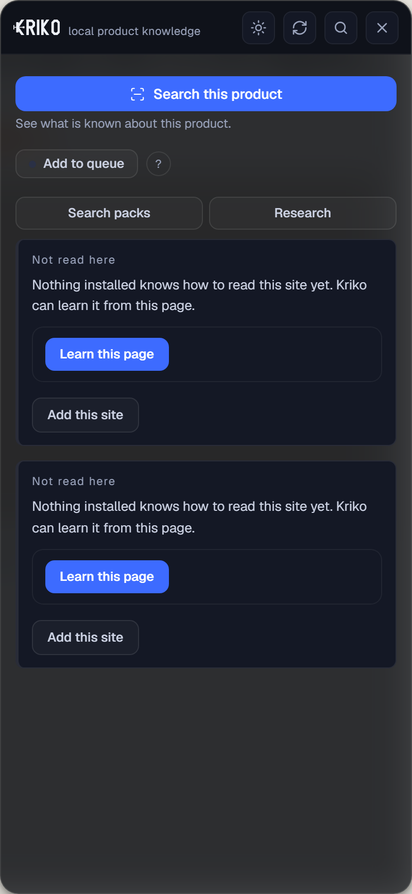

# The extension panel, with Compare inside it, 2026-10-25

Captured in headless Chromium from the panel's own files through
`extension/tests/preview/panel.html` (the page that stubs `chrome.*` and
delivers one stored answer). The panel code is the shipped code; the shortlist
in the compare pictures comes from the preview's stub (`?compare=two`), not a
running app, so the counts there are invented.

The reader's words: *"currently works fine but minimalism isn't there and
wording is too much, adding compare directly to there might be good move"*.

## Before and after

| Before | After |
|---|---|
|  |  |

What went:

- the **subtitle** under the wordmark, and the boxes around the four header
  keys;
- three pill-shaped counts (*serious*, *worth checking*, *minor*) become one
  line of numbers (*serious*, *to check*, *minor*);
- **Add to queue**, its **?** and the explanation it opened, **Decide between
  my shortlist** and **Search packs**: one search remains, in the header;
- **Expand all** and **Collapse all**: one toggle;
- the **Compare** button in the footer, which only opened the app.

## Compare, in the panel

*Add to compare* puts this page's product on the shortlist and opens it where
it was pressed. Each row is a product with how many risks of each severity its
stored check holds (*serious*, *to check*, *minor*), or *Not checked yet*.
A row comes off with its cross; *Open side by side* raises the app's Compare
screen; *Help me decide* (two or more products) asks the app to rank them.
The shortlist is the app's research queue, so nothing here is a second list.

| Dark | Light |
|---|---|
|  |  |

## Other states

| Light | Risks open | Page nothing reads |
|---|---|---|
|  |  |  |

| Idle, before |
|---|
|  |

Two things seen while taking these. The *Not read here* card appeared twice
over the preview, because the preview's stand-in for the worker answers
synchronously and the card was drawn once by each call; it is now replaced
rather than appended, so a reply that arrives early cannot double it. And the
footer ended with a dangling dot before the app link; the link is now alone on
its side.

Not captured: the options page (it needs the extension's own storage), and the
panel on a real listing site with the app running.
