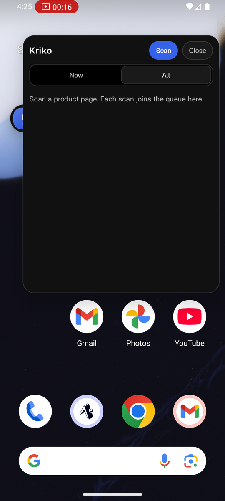
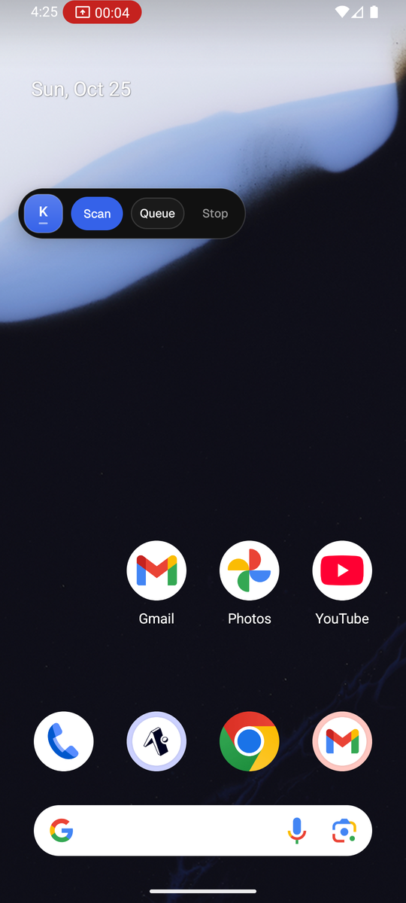
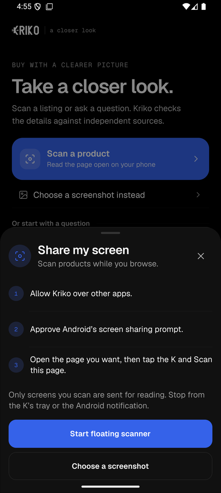
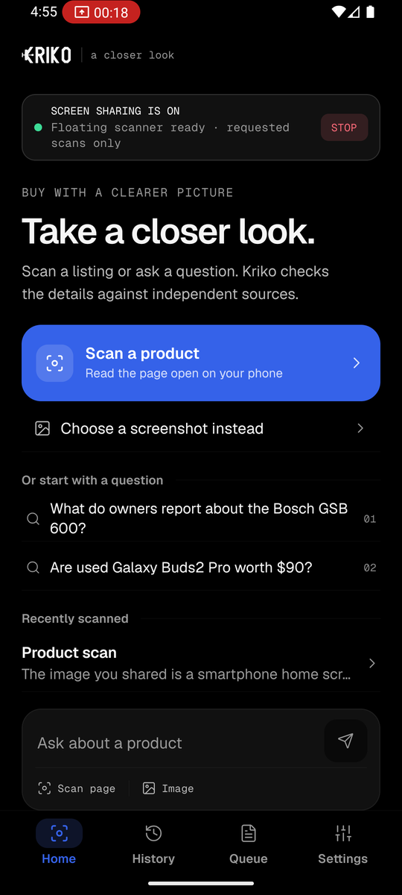
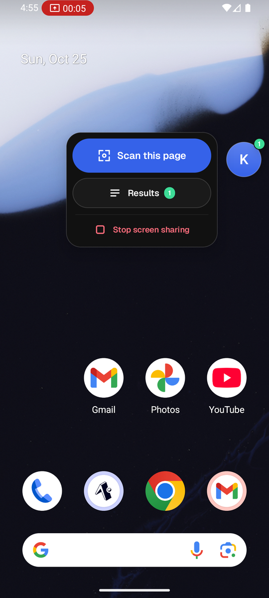
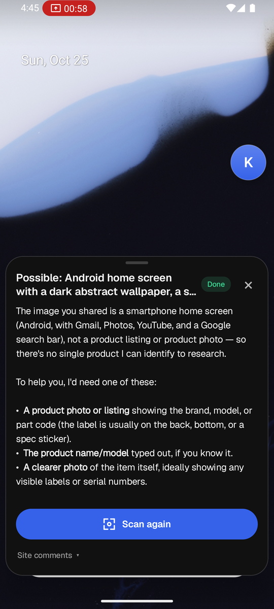
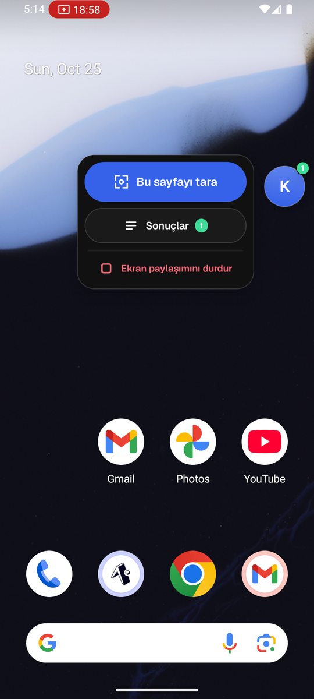
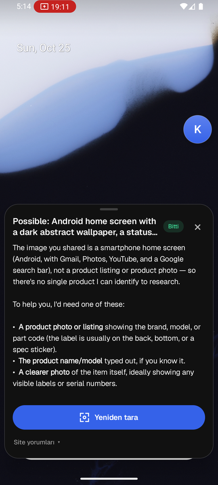

# The floating scanner, 2026-10-25

Captured on an Android 14 emulator (1080 × 2400, shown at half size) from a
release APK built for this change. These are the native views, which the web
preview cannot draw, so this is the first time the scanner is seen as it runs.

The reader's words: *"overhauling floating kriko tab on screenshare is not
stylised and hard to use"*.

## Before

A 24-line panel with a Now/All switch, two buttons and an empty queue, opened
by a bubble that was half hidden under it.

| Panel | Bubble |
|---|---|
|  |  |

## After

One small **K** puck, a tray with the one thing you came to do, and a sheet for
the answer.

| Start | The app steps aside | Tray | Answer |
|---|---|---|---|
|  |  |  |  |

| Tray, Türkçe | Answer, Türkçe |
|---|---|
|  |  |

What was observed on the emulator:

- **Starting** closes the sheet and sends Kriko to the background, so the page
  the reader wants is the one in front. It does not leave them on Kriko with a
  puck over it.
- The **puck** is 54 dp and sat on the right edge. A green badge counts the
  answers that are ready, and a ring turns on it while a scan reads (seen in
  an earlier capture of the same build, not repeated here). It is written to
  drag, snap to the nearest edge and dim when idle; those three were not
  exercised on the emulator.
- **While Kriko itself is in front the scanner is hidden**, and it returns
  when the reader leaves (the tray picture is the same session, one tap on
  Home later). It used to sit over Kriko's own tabs.
- The **tray** is one primary key (*Scan this page*), *Results*, and a quiet
  red *Stop screen sharing*.
- The **sheet** is anchored to the bottom, sized to its content, and never
  covers the puck. It shows the state (*Reading*, *Done*), the answer, and
  *Scan again*.
- **Türkçe**: the tray, the sheet's state chip, *Yeniden tara* and *Site
  yorumları* change with the app's language. The answer text in the last
  picture is the English answer saved before the switch; an answer is written
  in the language it was asked in.

Not observed: a light palette on the scanner (the palette travels as data from
the app; only dark was captured), and a real product page under the scanner
(the emulator has no browsing session; the scan in these pictures read the
launcher, which is why the answer says it is not a product).
