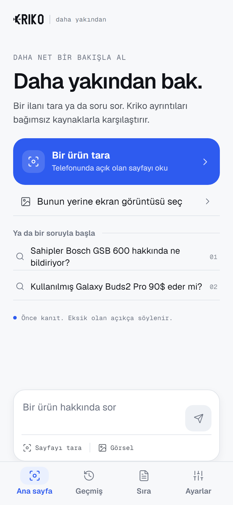
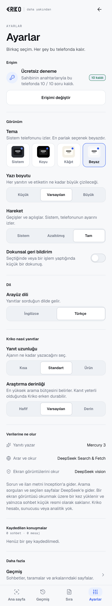
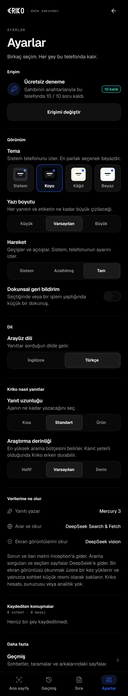

# Mobile overhaul, 2026-10-25

Captures of the mobile overhaul, taken from the **Expo web preview** in headless
Chrome at a 390 px phone width. No Android APK or native build was made for this
pass, at the reader's request.

| White, Turkish | White, Turkish — Settings | Dark, Turkish — Settings |
|---|---|---|
|  |  |  |

The settings capture is 390 × 2100 so the whole screen is visible in one image;
the others are 390 × 844.

What the captures show:

- the runtime **White** palette, selected under Appearance, with Dark and Paper
  beside System;
- **Türkçe** across the home screen, settings, labels, descriptions, chips,
  dialogs and accessibility text;
- the new settings: theme, text size, motion, haptics, language, answer length
  and research depth.

Not shown here: the Android floating scan capsule and its panel. Those are
native Android views and need an installed build; the web preview cannot draw
them. They were redrawn afterwards and captured on an emulator, in
[2026-10-25-floating-scanner](../2026-10-25-floating-scanner/README.md).

The two problems these captures caught and the change fixed: the haptics
description ran under its switch at 390 px, and the saved-conversation counter
clipped at the right edge.
