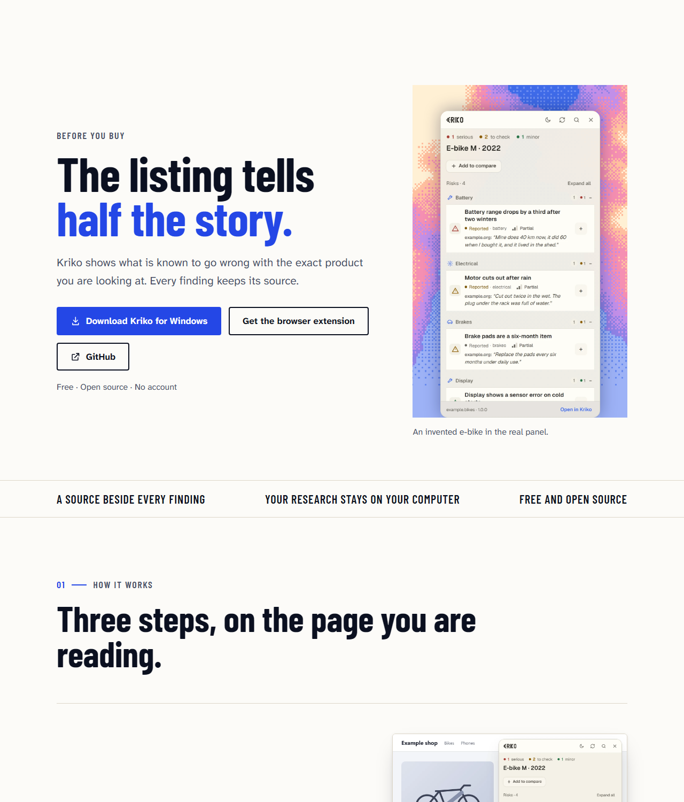
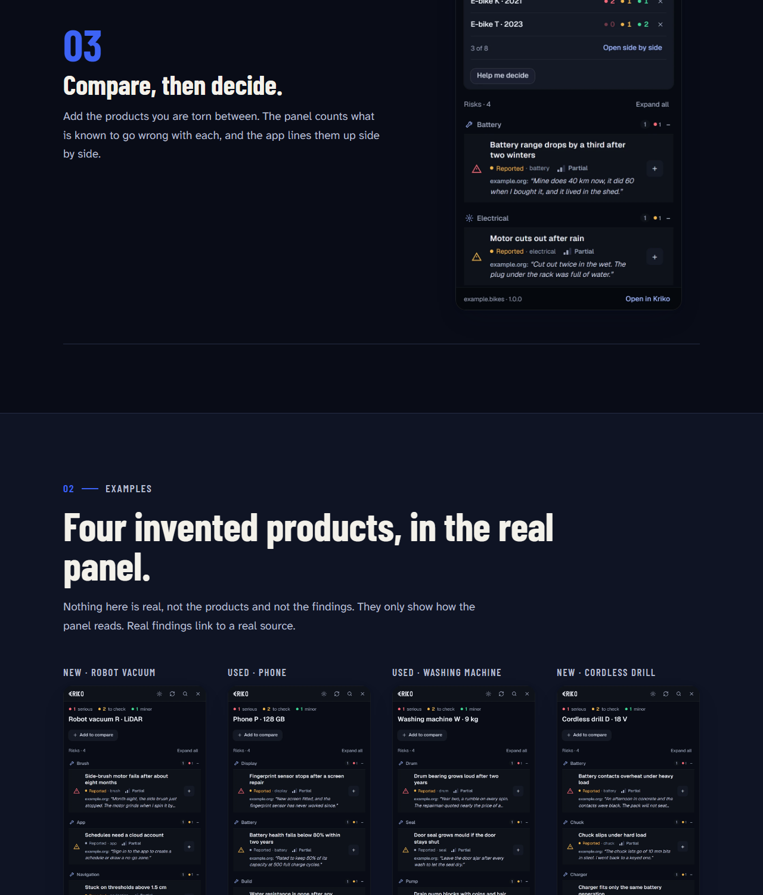
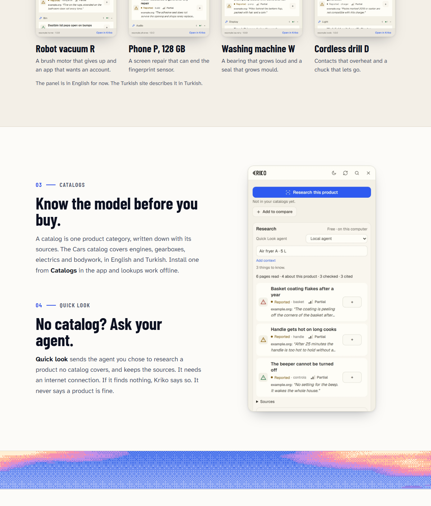
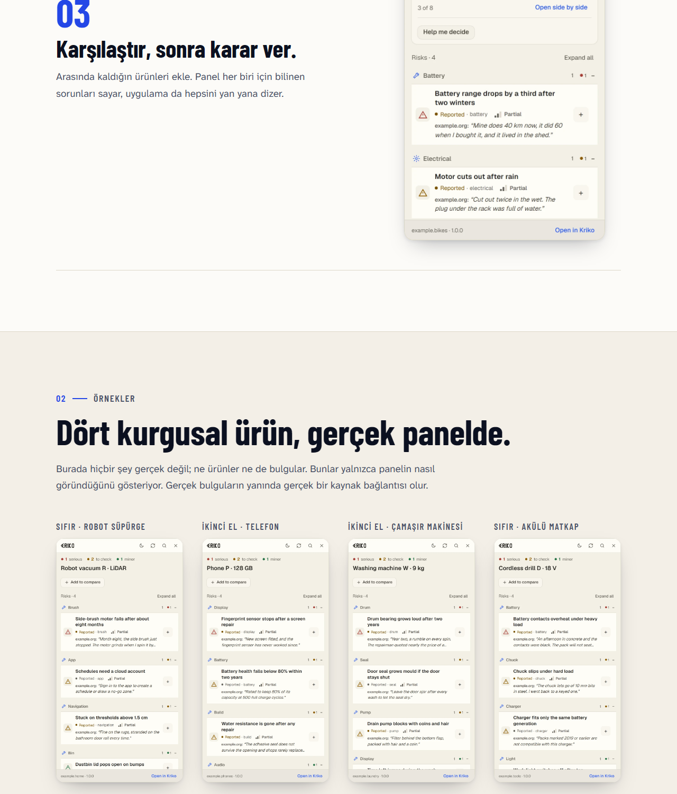
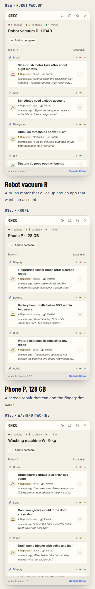

# The website, with new examples, 2026-10-25

Captured in headless Chromium from the site's own files (`site/`, served as
static files), at 1280 px wide and at 390 px for the phone. The pictures of the
panel inside the page are drawn by `site/tools/capture.mjs` from the shipped
extension code, so they show the redone panel, Compare included.

The reader's words: *"overhauling the website, completely changing the
examples"*.

## What changed

- **Every example is new.** The hatchback, laptop, headphones and espresso
  machine are gone. The page now follows one invented e-bike through the three
  steps (the listing, one finding opened, the shortlist), and the gallery shows
  four other invented products: a robot vacuum, a phone, a washing machine and
  a cordless drill. The research card is an air fryer. All findings, quotes and
  sources are invented and point at `example.org`.
- **Compare is on the page.** Step three is the panel's shortlist, with the
  counts per product. It used to be a footer button the page never mentioned.
- **Fewer words.** Shorter headline label, shorter steps, one line for
  Catalogs and one for Quick look, which now sit beside the research picture.
- **The Turkish page** is rebuilt from the English one (`render-locales.cjs`),
  with every unit translated and the obsolete translations dropped.

| Top of the page | Compare, then the gallery (dark) |
|---|---|
|  |  |

| Gallery and catalogs (light) | Turkish, same part |
|---|---|
|  |  |

| Phone |
|---|
|  |

## Seen while taking these

- The dark pictures first came out in the light theme: the panel's theme is the
  reader's stored choice, not the browser's, and the capture did not set it.
  `capture.mjs` now names the theme for each picture.
- The unknown-product panel carried three buttons that all started the same
  research (the primary key, a *Research* key beside *Add to compare*, and one
  in the card). The card's and the extra key now stay out of the way while the
  primary key does the job (`extension/hover_lite/hover_lite.js`), and the test
  for that state asserts one.

Not checked: a real browser at other widths between 390 and 1280, and the
pages on the published address (this is the working tree, not a deploy).
