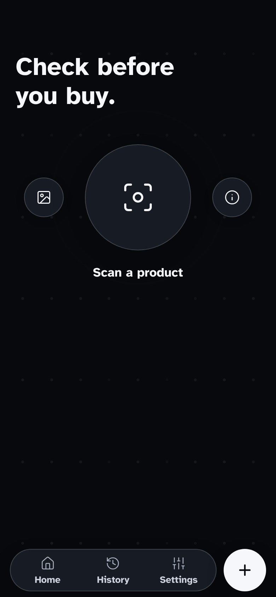
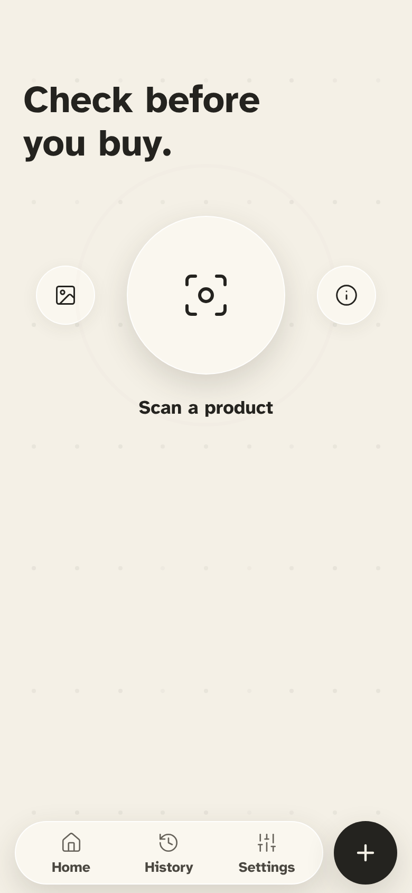
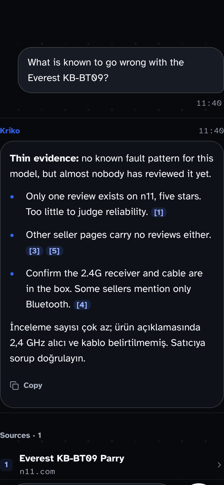
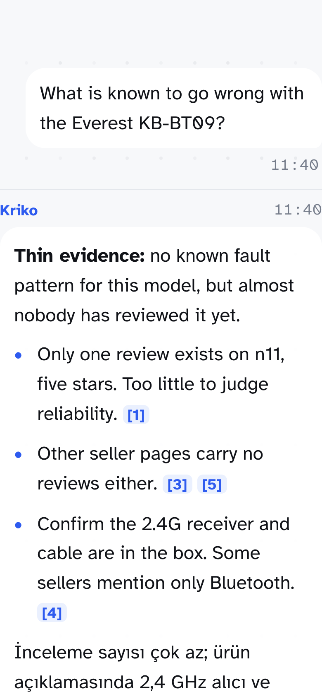
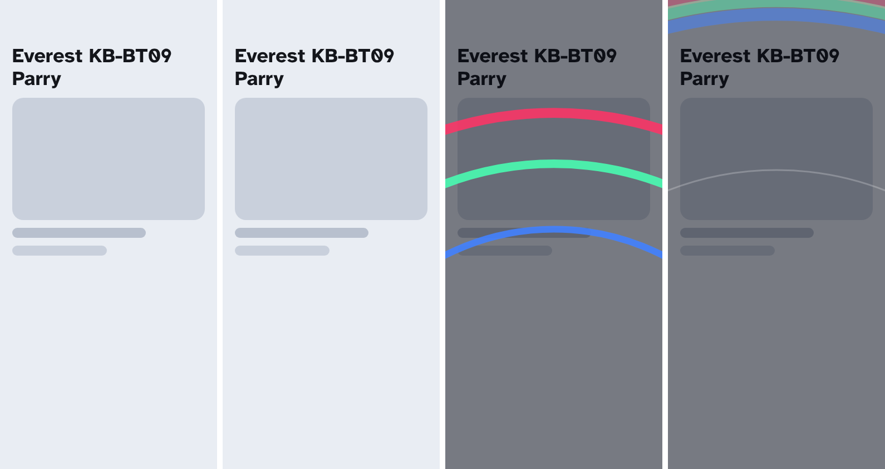

# Glass redesign on 0.15.0, 2026-11-03

Captures taken from the **Expo web export** in headless Chrome at a 390 px phone
width, through a throwaway preview route that was not committed. No Android
APK or native build was made, so the glass blur, the haptic and the native
overlay windows are **not** shown.

| Home, dark | Home, paper |
|---|---|
|  |  |

| Chat, dark | Chat, white, Extra large text |
|---|---|
|  |  |

The assistant call's shockwave, four frames across about a second (the page
dims, then a red, green and blue front crosses the screen with a faint echo):

What the captures show: Atkinson Hyperlegible in every size, with Turkish
`İ ı ğ ş ç ü` drawn correctly; the scan orb, the floating pill and the separate
New chat button; answers on a reading plate with bold citation chips; the
neutral background field with no coloured circles; text that wraps cleanly at
the Extra large step.

The chat captures lack the list's page margins because the preview route did not
use the chat list; the app's own chat does.
