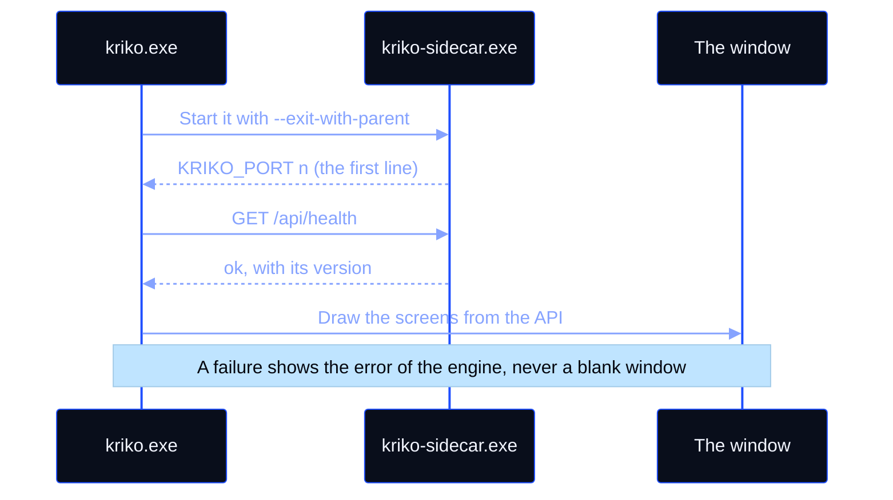

# The Kriko desktop app

This folder holds the desktop app. It uses Rust and GPUI. The app supervises
the engine and draws every screen from the local HTTP API. It holds no engine
logic. The browser extension is a separate part of the tree, in `extension/`.

Run it from a source checkout:

```
cargo run --release
```

Every asset is inside the binary: the fonts, the nav icons, the sky images, and
the wordmark. The program runs from any folder, and it needs no asset path.

## The files

| File | Function |
|---|---|
| `src/theme.rs` | The look: the colour tokens, the shadows, and the small builders (card, well, switch, tag, meter, and others). Every gap and inset is a token here. |
| `src/app.rs` | The shell: the sidebar, the nav groups, the page head, the keys, and the text fields. |
| `src/data.rs` | The fixed words of the screens: the rail, the page size of the history, and the compare suggestions. |
| `src/dock.rs` | The live actions bar: the requests that need you, the working lanes, the feed, and the reply field. |
| `src/engine.rs` | The engine supervisor. |
| `src/shell.rs` | The tray, the hide-on-close behaviour, and one Kriko for each machine. |
| `src/api.rs` | The HTTP API of the engine from the side of the window. It uses the loopback address and one request at a time. |
| `src/screens/` | One file for each tab. Each file is a function over the shared state. |

## The engine supervisor

The app is a supervisor. It is not a second engine. `src/engine.rs` finds the
engine, waits until the engine answers, and stops the engine with the app.



The engine comes from the first of these that is available:

1. `KRIKO_URL`, if you set it. The app attaches and starts nothing.
2. `kriko-sidecar` beside `kriko.exe`. The app starts it.
3. An engine that already answers on the selected port. The app attaches to it.
4. `python -m app.sidecar`. The variable `KRIKO_PYTHON` selects the
   interpreter.

| Moment | Result |
|---|---|
| Handshake | The first line with `KRIKO_PORT` names a port that the engine already holds. |
| Crash belt | `--exit-with-parent` makes the engine watch its input. If the app stops in any way, the engine stops too. |
| Failure | The engine did not start, did not answer, or stopped. The window shows the last 24 KiB of its error output. |
| Close the window | The window hides. The engine continues, because the browser extension needs it. |
| **Quit** in the tray | The app stops the engine, then itself. On Windows the stop is a tree kill, because a one-file bundle starts a second process. |
| An attached engine | The app leaves it. It was not the engine of this app. |
| A second start | On Windows, the first window comes to the front and the second app stops. |

## The screens

The rail has four groups:

- **Check**: Home, Run, History, Compare, Chat, Browser extension
- **Knowledge**: Overview, Browse
- **System**: Sites, Activity, Agents, Benchmark
- **This install**: Local LLM, Settings, About

| Screen | Contents |
|---|---|
| Home | The totals, the work that waits, the latest checks, and the app update |
| Run | The steps of the selected check, the lanes of the agents, the decision card, and the log |
| Chat | The conversation and the sources beside each answer |
| Compare | Up to four saved checks, cell by cell, and a drawing board over the shortlist |
| Overview | The catalogs to install, the installed catalogs, the gaps, and **File quick looks** |
| Browse | The table of products and the drawer of evidence |
| Agents | The table of agents, the model, the MCP port, and the permissions |
| Local LLM | The server card, the models, the tuning, and the memory of the graphics card |
| Settings | General, shortcuts, privacy, and the danger zone |

Two variables help a review session:

- `KRIKO_VERIFY=1` opens one separate window. A route such as `settings` or
  `compare` opens that screen, and the window never attaches to a running
  Kriko.
- `KRIKO_WINDOW_SIZE=WxH` opens the window at that size, for example the
  minimum `940x640`.

## Build the installer

Build the Windows installer and the portable ZIP on Windows:

```
powershell -ExecutionPolicy Bypass -File kriko-gpui/package.ps1
```

The MSI step needs the WiX 3 toolset (`candle` and `light`) and the command
`cargo install cargo-wix`. If WiX is not in `PATH`, give its folder:
`.\kriko-gpui\package.ps1 -WixBin C:\path\to\wix314`.

Build the macOS app on the machine that it targets:

```sh
kriko-gpui/package-macos.sh arm64      # Apple Silicon
kriko-gpui/package-macos.sh x86_64     # Intel
```

The script examines the host and each bundled program, checks the pinned
release archive of the search service, and smoke-tests the app. The build
writes these files to `kriko-gpui/builds/`:

| File | Contents |
|---|---|
| `kriko-<version>-x86_64.msi` | The per-user installer for Windows. It needs no administrator rights and it writes to `%LOCALAPPDATA%\Programs\Kriko`. |
| `kriko-<version>-win64-portable.zip` | `kriko.exe` and `kriko-sidecar.exe`, without an install. |
| `kriko-<version>-macos-<arch>.dmg` | The disk image with `Kriko.app` and a link to Applications. |
| `kriko-<version>-macos-<arch>-portable.zip` | The complete app bundle for macOS. |
| `SHA256SUMS-<arch>.txt` | The hashes of the macOS files. |

Both programs ship in every Windows package, because the app starts the engine
from its own folder. The installer stops a running Kriko first, because a live
engine holds its own program file.

The Windows installer is unsigned, and so are the macOS packages, unless the
release says differently. Windows can show a SmartScreen warning. On macOS, set
`KRIKO_MACOS_SIGN_IDENTITY` to sign, and `KRIKO_MACOS_NOTARY_PROFILE` to
notarize.

## Motion

Four animations run: the boot flicker of a live tag, the blink of a tag that
needs you, the slide of a switch, and the slide of a segmented control.
**Reduce motion** in Settings stops each one.

Only the window in front moves, and only work in flight repeats. An animation
that repeats without end costs a processor core, because GPUI draws the window
again for each frame. The file `src/app/tests/test_the_idle_window_does_not_draw.py`
holds the list of functions that can repeat.
