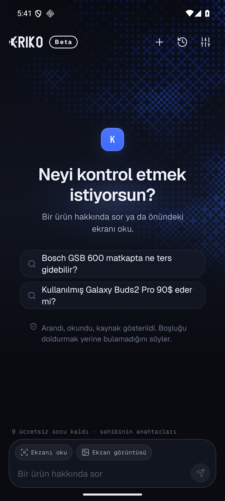
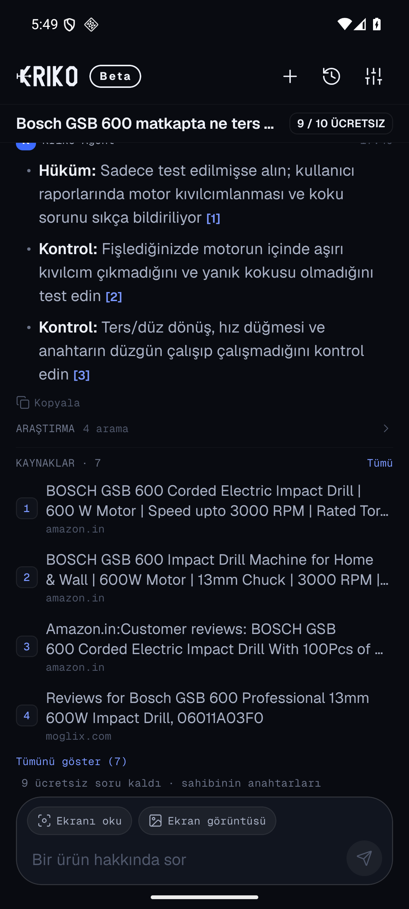
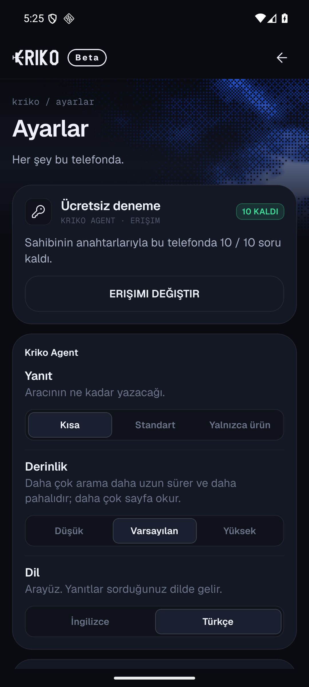
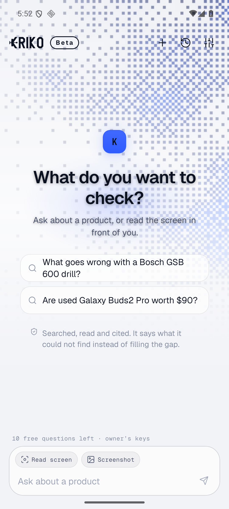
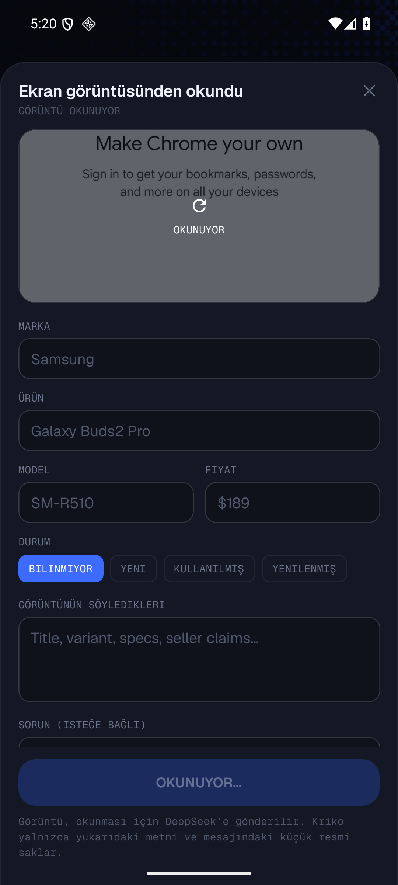

# Kriko Agent for mobile

Kriko Agent, alone, on a phone. Ask what is known to go wrong with a product,
or read the screen in front of you. The answer is researched on the open web,
cites the pages it read, and says when it could not find enough.

This is the friends-test build. It is the agent only: no catalog browser, no
extension, no desktop engine. The Mercury and DeepSeek keys belong to the person
who shared the build, and a new install can ask ten questions on them without a
code.

| | |
|---|---|
| **Ask** | One question, a screenshot, or the phone's own screen. |
| **Identify by appearance** | Product photos work without a readable name. Visual clues and possible matches stay separate from confirmed model text and are preserved in scan history. |
| **Answer length** | Choose a concise answer, a fuller explanation (usually 150–300 words when useful), or a product-focused answer. The question still determines the format. |
| **Watch it work** | Every search and every page read is shown while it happens. |
| **Check the sources** | The numbered pages sit under the answer and have their own page. |
| **Open a screen** | Ask to see your history or settings and the answer offers an Open button. Nothing navigates without your press. |
| **Scan over the page** | Drag the blue K to place the floating scanner. Scan, open the queue, or stop sharing from its controls. |
| **Queue products** | Follow live scan steps, formatted answers and clickable sources in the floating panel or app. |
| **Recover scans** | Scan results appear in History; waiting jobs resume after reopening and interrupted jobs are marked for another scan. |
| **Turkish or English** | The whole interface switches in Settings, in place. A coverage test keeps every screen string translated. |
| **Appearance** | Dark, paper and pure white palettes, chosen at runtime — plus system, three text sizes, reduced motion and a haptics switch. No second APK. |

| Ask (dark) | Short answer (Turkish) |
|---|---|
|  |  |

| Settings (Turkish) | Paper theme |
|---|---|
|  |  |

| Listing confirmation | |
|---|---|
|  | |

The captures are from a Pixel-sized Android 16 emulator, not a mock.

## A friend's first run

1. Open the APK on the phone and allow installing from this source.
   Android will warn that the app is not from the Play Store; that is expected.
2. Ask. Ten questions are included, on the owner's keys. The first launch
   pauses for a moment while the phone opens the sealed trial; later launches
   read it from secure storage.
3. For more, open **Settings → Replace access** and paste the access code and
   the password. They are sent in two separate messages on purpose: either one
   alone is useless.

Nothing needs an account, a server, or a connection to the owner's computer.

## Settings on the phone

The screen follows the desktop's vocabulary, cut to what a fixed phone stack
can actually honour:

- **Answer**: Short keeps the response concise, Standard asks for a useful,
  supported explanation (usually 150–300 words when research merits it), and
  Product only focuses on the identified item and question. The prompt guides
  length and focus; the question determines whether prose, bullets, or another
  structure fits.
- **Thoroughness**: Low / Default / High set maximum search budgets of 3 / 5 / 8
  lookups and 2 / 4 / 5 results per lookup. The agent can stop earlier when
  evidence is sufficient, searches add little new information, or it needs to
  reserve time to answer.
- **Language**: English / Türkçe, applied instantly across the interface and
  the floating scanner. The answer is written in the same language as the
  interface.
- **Theme**: System, Dark, Paper or White. System follows the phone; White is a
  pure cool white, Paper is the desktop's warm canvas. Switching is immediate
  and needs no rebuild.
- **Text size**: Small, Default or Large, applied to every text token and input.
- **Motion**: System, Reduced or Full. System follows Android's remove-animations
  setting.
- **Haptics**: one switch for every tap, press and completion.
- **Access**: trial count, access code, forget the shared keys.
- **Conversations**: every chat, scan results, clear all, History and About pages.
- **Privacy**: the exact list of what leaves the phone.
- **Reset preferences**: puts every choice on the screen back to its default,
  leaving keys, chats and scans alone.

## Floating scanner and product queue

The Android build keeps a draggable Kriko bubble over a shopping page. Drag its
blue **K** handle to move it. The bubble has **Scan**, **Queue** (with an active
job count), and **Stop** controls. The app also shows a visible “Screen sharing
is on” banner with its own **Stop** button. Start the scanner once and approve
Android's screen-capture and display-over-other-apps prompts. Each tap on
**Scan** captures one frame; the overlay briefly hides itself so it does not
capture its own controls.

The floating panel has **Now** and **Queue** tabs. Answers use readable
headings, paragraphs, and bullets instead of raw Markdown, and citations and
source links open their pages. A live spinner and research steps show actual
work in progress. Each scan joins the in-app and floating-panel queue; jobs run
one at a time, keep separate conversations and sources, and can be cancelled
while waiting or running. The app's History page keeps scan results alongside
chats. Waiting jobs resume when Kriko opens again; a job interrupted mid-run is
marked with instructions to scan that product again.

The floating panel also offers **Read site comments**. The optional site URL
scopes searches and accepted pages to that host and its subdomains; without a
URL, Kriko uses an unambiguous domain visible in the listing or question, and
asks for one if it cannot determine the site safely. It does not treat other
sites' comments as evidence for this mode.

Screenshot reading is one fast pass. The phone sends the full frame and, for a
tall listing, a tighter crop of the title/label band, then asks vision for strict
JSON with reasoning turned off — the reading takes a few seconds instead of
spending the whole reply budget on hidden reasoning. If the shape is still
wrong it retries once, and a reply that arrives as prose becomes editable
listing text rather than a failure. If the image still cannot be read, choose
**Try reading again** or enter the listing details by hand. The question field
is optional; the app can research from the identified product alone.

The native overlay requires the installed Android build; it is unavailable in
Expo Go. Android's screen-capture indicator remains visible during capture.

## What leaves this phone

- The question, and the listing text read from a screenshot or screen capture,
  go to **Inception** (Mercury 3), which writes the answer.
- Search queries and the URLs the agent chooses go to **DeepSeek**, which
  returns the pages. Every search is paced under DeepSeek's account limit.
- A screenshot or requested screen capture is uploaded to DeepSeek's vision
  model to read the listing. The result is shown and editable before research;
  the question is optional.
- There is no Kriko account, no Kriko server, no analytics. Chats live in the
  app's storage on this phone.

The access code carries the owner's keys sealed with AES-256-GCM under a key
derived by scrypt from the password **and a pepper baked into this build**. A
code and its password open nothing outside a Kriko build. Anybody who can run
this app and inspect it can still recover the keys — that is what sharing them
means, and the owner's real protection is rotation at the providers. The ten
free questions are a courtesy kept on the phone, not a wall.

## Where the pieces are

```
src/
  app/                 expo-router: chat, history, sources/[id], settings, about
  screens/             ChatScreen, Landing, WelcomeScreen
  components/          chrome, composer, message/markdown, queue and scan sheets
  theme/
    palettes.ts        dark, paper and white, with the same keys
    theme.tsx          runtime ThemeProvider, useColors, makeStyles
    preferences.ts     appearance, text size, motion; defaults and guards
    feedback.ts        one switch for every haptic
  engine/
    providers.ts       Mercury streaming + DeepSeek tools + the turn loop
    prompt.ts          the agent's contract, answer styles, screenshot brief
    visionimage.ts     label-band crop for tall screenshots
    screen.ts          MediaProjection capture, frame selection, cleanup
    sharekeys.ts       the desktop's shared-access protocol, on the phone
    store.tsx          keys, prefs, language, conversations and scan queue
    secrets.ts         generated: pepper, sealed trial, not committed
  i18n.ts              English/Turkish dictionary, patterns and coverage helper
```

The turn loop uses up to four research rounds and a thoroughness-based maximum
of 3–8 retrievals, with 2–5 results per search and a 120-second deadline. It
can stop early when evidence is sufficient, searches add little new information,
or the remaining time needs to be reserved for a final answer. Searches are
paced by 0.22 seconds, and every bound ends the turn with a sentence. Search results carry the number
the answer must cite, so `[1]` in the answer and `[1]` under it are the same
page even when two searches finish out of order. If the model writes a good
answer as one paragraph, the phone rebuilds its `Verdict`/`Check`/`Gap` markers
as bullets before it is shown.

## Build it

Requires Node 24, JDK 17, the Android SDK (platform 36+), and an Android signing
configuration. The current app version is **0.10.0** (Android version code **10**).
This build uses the debug keystore, so the APK installs and
updates locally but is not a Play Store artifact.

### The Windows path-length trap

Android's CMake mirrors every source path into the object directory. In a
checkout at `C:\Users\beraat\prj\kriko`, one worklets object path is 263
characters; ninja cannot create it and the build dies with

    ninja: error: mkdir(CMakeFiles/worklets.dir/C_/.../Serializable):
    No such file or directory

`CMAKE_OBJECT_PATH_MAX` shortens object **names**, not the mirrored
**directories**, and a newer CMake/Ninja does not change that. The layout that
built 0.6.0 on this Windows machine is:

- the packages live at `C:\nm\node_modules`, and the checkout's `node_modules`
  is a junction to it;
- the native packages with the longest generated codegen paths are junctioned
  to short roots: `react-native-reanimated → C:\r`,
  `react-native-safe-area-context → C:\sa`, `react-native-screens → C:\sc`,
  `react-native-svg → C:\sv`, `react-native-frame-capture → C:\fc`; each has a
  `node_modules` junction back to `C:\nm\node_modules`;
- `react-native-gesture-handler` is excluded from the Android build in
  `react-native.config.js`. The app uses the native stack, which does not need
  it, and its generated codegen path was the longest in the project;
- the source is staged at `C:\a` and built there. The longest remaining object
  path is under 260 characters.

Two library fixes are applied to `node_modules` (not to this repository) because
`react-native-frame-capture` 1.2.1 predates React Native 0.88:

- `FrameCaptureModule.kt`: `currentActivity` → `getCurrentActivity()`.
- `PermissionHandler.kt`: on Android 14+, request with
  `MediaProjectionConfig.createConfigForDefaultDisplay()` so **entire screen** is
  the only mode. Without it Android 15 offers "share one app" first.

```powershell
robocopy kriko-mobile C:\a /E /XD node_modules android .expo .git
cmd /c mklink /J C:\a\node_modules C:\nm\node_modules
cd C:\a
npx expo prebuild --platform android --no-install
cd android
.\gradlew.bat :app:assembleRelease "-PreactNativeArchitectures=arm64-v8a,x86_64" --no-daemon
```

The APK is at `C:\a\android\app\build\outputs\apk\release\app-release.apk`.
On macOS or Linux none of this is needed; build from the checkout.

### Themes are runtime, not a second APK

Dark, paper and white live in `src/theme/palettes.ts`, and `ThemeProvider`
chooses one at render time from the reader's setting. A theme change rebuilds
the stylesheet from the same tokens, so there is nothing to set in Gradle and
no second bundle to install. `app.json` keeps `userInterfaceStyle` at
`automatic` so native dialogs follow the same choice; the splash stays on the
black brand surface during the first frame.

### The baked secrets

`src/engine/secrets.ts` is generated and gitignored. It carries the build's
share pepper and the sealed trial bundle. From the repository root, with the
desktop environment available:

```powershell
.venv\Scripts\python.exe kriko-mobile\tools\make-secrets.py `
    --shared-home <a Kriko home with the owner's grant> `
    --password "<the friends' password>" --questions 10
```

It writes `src/engine/secrets.ts` and `.friend-access.txt` (also gitignored),
prints the password and code, and refuses to write a trial it cannot reopen.
`npx tsx tools/verify-secrets.ts` checks that the phone's crypto opens both the
trial and the code — it prints digests, never keys.

A build without `secrets.ts` does not type-check: generate it first. A build
with empty values offers no trial and opens no access code, which the welcome
screen says.

## Checks

```powershell
cd kriko-mobile
npx tsc --noEmit
npx expo lint
npm run test:offline                   # turn, screen, queue, history, vision, i18n
npx tsx tools/verify-secrets.ts        # crypto against the desktop seal
npx tsx tools/smoke-vision.ts          # four real product photos, real keys
npx tsx tools/smoke-providers.ts       # vision + search, real keys
npx tsx tools/smoke-turn.ts            # one full turn (npm i --no-save xhr2)
```

The offline suite includes `tools/test-i18n.ts`, which walks every JSX label,
placeholder, alert and thrown message and fails when one has no Turkish
counterpart, and `tools/test-theme.ts`, which proves the three palettes share
one key vocabulary. The smoke tests spend the owner's keys. They print no keys.

## Limits of this build

- The APK is signed with the debug keystore. Rebuilding with another
  keystore means uninstalling first.
- The ten-question count is stored on the phone and resets with app data.
- A friend can recover the shared keys from their own device. Rotate the keys
  at the providers to revoke every code made from them.
- Search quality is the weak point: a forum query can still return shop pages.
  The source list is always shown; the build does not quote-validate every
  claim.
- Vision reads a visible label, not a hidden one. A model code that is not
  legible in the frame stays empty, and the crop is a heuristic for tall
  images, not a substitute for a closer photo.
- Screen reading is Android-only, and it asks for screen access per read. A few
  apps set FLAG_SECURE and will capture black.
- Mercury and DeepSeek are third-party services with their own availability,
  prices and terms. The agent is pinned to `mercury-3` and
  `deepseek-flash` for vision.
- This is a test build for friends, not a store release.
