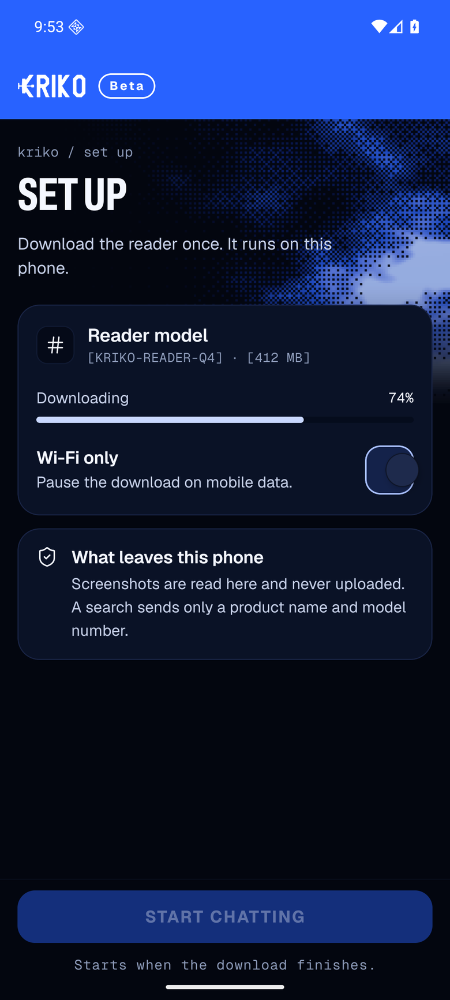
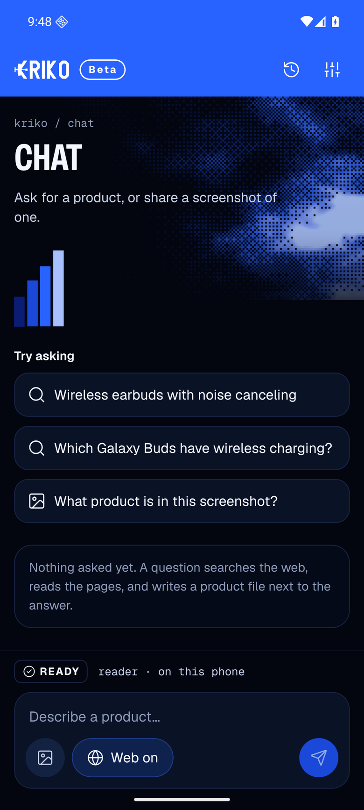
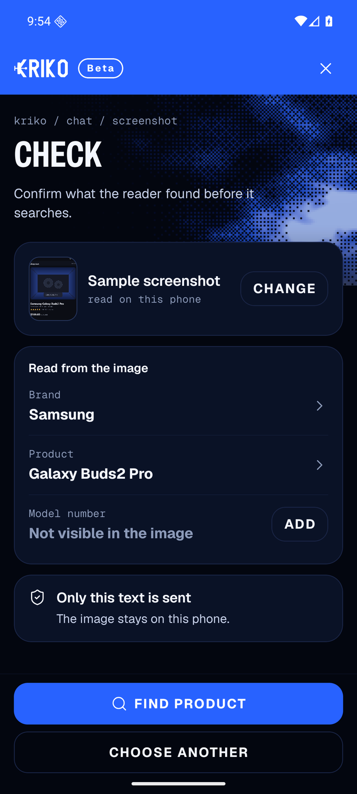
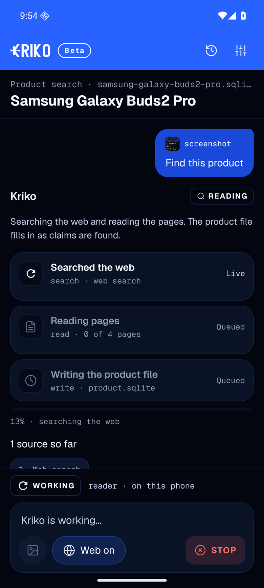
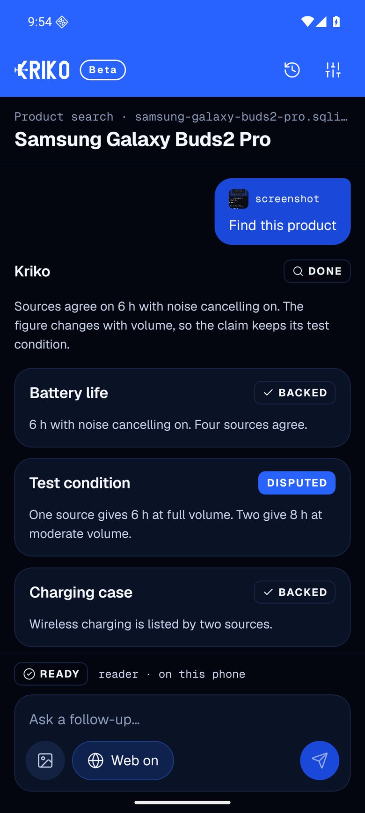

# Kriko for mobile

The Kriko reader, on the phone. A screenshot is read on the device; a search
sends a product name and a model number and nothing else.

This is a React Native app on Expo (SDK 58, React Native 0.88), built to the
five screens of the mobile design. It runs in **Expo Go**, so there is no
development build to make before you can look at it.

| | |
|---|---|
| Set up |  |
| Chat |  |
| Check |  |
| Searching |  |
| Results |  |

## Run it

```bash
cd kriko-mobile
npm install
npx expo start --android      # or: npx expo start, then press a
```

With no emulator or device attached, `npx expo start` prints a QR code for Expo
Go on a phone on the same network.

Type checks and lint:

```bash
npx tsc --noEmit
npx expo lint
```

## The Android testing environment

`tools/android-setup.ps1` installs everything the app needs to be observed on a
real Android build, without Android Studio:

| Piece | Where | Notes |
|---|---|---|
| Temurin JDK 17 | `C:\Android\jdk` | portable zip, no admin rights |
| Android SDK | `C:\Android\Sdk` | `platform-tools`, `emulator`, `platforms;android-36`, `build-tools;36.0.0` |
| System image | `system-images;android-36;google_apis;x86_64` | Android 16, x86_64 |
| AVD | `kriko_pixel` | Pixel 6 profile, in `%USERPROFILE%\.android\avd` |

```powershell
powershell -ExecutionPolicy Bypass -File tools\android-setup.ps1
```

Then boot it and open the app:

```powershell
$env:ANDROID_HOME = 'C:\Android\Sdk'
& "$env:ANDROID_HOME\emulator\emulator.exe" -avd kriko_pixel -no-boot-anim -gpu swiftshader_indirect
adb reverse tcp:8081 tcp:8081
adb shell am start -a android.intent.action.VIEW -d "exp://127.0.0.1:8081?__expo_disable_fab=1"
```

`adb reverse` plus `127.0.0.1` is the reliable way in; a LAN address depends on
the guest's route to the host. `__expo_disable_fab=1` hides Expo Go's floating
menu button so screenshots show the app alone.

Two things about this emulator, both observed:

- **Software rendering is slow but stable.** With `-gpu host` the guest wedged
  twice (system UI and launcher stopped responding). `swiftshader_indirect` is
  slower to boot and does not fall over.
- **It has no photos.** `adb push` the sample listing and scan it, or the
  screenshot flow has nothing to pick:

  ```powershell
  adb push src\assets\sample-listing.png /sdcard/Pictures/kriko-sample-listing.png
  adb shell content call --uri content://media/external/images/media `
      --method scan_file --arg /sdcard/Pictures/kriko-sample-listing.png
  ```

`tools/shot.ps1 -Name <name>` captures the screen into `.preview/shots/`.

## How the screens are built

```
src/
  app/                 expo-router routes: every file here is a screen
    _layout.tsx        fonts, safe area, the stack
    index.tsx          set up until the reader is installed, then chat
    setup.tsx          the reader download
    chat.tsx           ask, or share a screenshot
    check.tsx          confirm the reading, then search
    product/[id].tsx   one run: searching, then the claims it wrote
    settings.tsx       the reader, the web switch, this device's history
  components/          the chrome, the primitives and the parts of a run
  engine/              the store, the run plan, the domain types
  theme/               tokens and the one Text component
  assets/              traced wordmark, dithered hero, sample listing
```

- **`engine/research.ts` is a pure function of time.** `plan()` builds the work
  and `advance(plan, elapsedMs)` says what is true at that moment. Nothing
  schedules a timer per step, so stopping a run, reopening it from history, and
  the progress bar all agree.
- **`engine/store.tsx` holds one clock.** A run records when it started; the
  store ticks `now` while anything is live, and every screen derives what it
  shows from that. State is written only for real events (a run finished, the
  reader installed), never per tick.
- **The reader is simulated.** The download takes eleven seconds and reports its
  progress as a function of elapsed time; `wifiOnly` is a stored preference.
- **The research answer is a fixture.** `plan()` returns the sources, claims and
  summary for `samsung-galaxy-buds2-pro` from the design, and a generic shape for
  anything else. The shapes match what a real search-then-read pass produces, so
  wiring a live engine in means replacing `plan()`, not the screens.

## Where the design came from

The interface is not eyeballed from the captures. Each token is measured, and
the measurements are in the repository so they can be repeated:

| Tool | What it recovered |
|---|---|
| `tools/trace_logo.py` | the KRIKO wordmark, traced from the brand artwork into SVG path data (`src/assets/logoPaths.ts`) |
| `tools/measure_ui.py` | the type scale: every text run in the captures solved against the real font files |
| `tools/measure_type.py` | the display face: "SET UP" is 100 px wide at a 29 px cap height, which Geist misses by 43 px, so screen titles are Archivo pinned to the narrow end of its width axis |
| `tools/make_fonts.py` | that instance, saved as `assets/fonts/KrikoDisplay-*.ttf` |
| `tools/generate_assets.py` | the dithered hero field and the app icons |
| `tools/generate_sample_shot.py` | the sample store listing the app falls back to |
| `tools/compare.py` | a screen next to its reference at the same scale, with a 50 % blend so a shift of two pixels shows |

```bash
python tools/measure_ui.py
python tools/compare.py chat .preview/shots/chat.png 2
```

The blend is the honest test: the remaining difference between the build and the
capture is the Android status bar, which the design captures do not have. The
sheets are kept beside this file — reference, build, and a 50 % blend:

| | |
|---|---|
| [Set up](docs/compare/setup.png) | [Chat](docs/compare/chat.png) |
| [Check](docs/compare/check.png) | [Searching](docs/compare/searching.png) |
| [Results](docs/compare/results.png) | |

## What is real, and what is not

Real: navigation, the reader install state and its persistence, the run engine
and its timing, stopping a run, history, settings, correction of the reader's
reading, the photo picker, and the absence of a network in the reading path.

Not real: the reader (a stub that takes eleven seconds), the search and the pages
it reads (fixtures), and the catalogs. Nothing in this app opens a socket.
